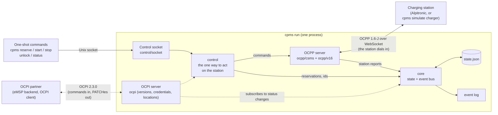
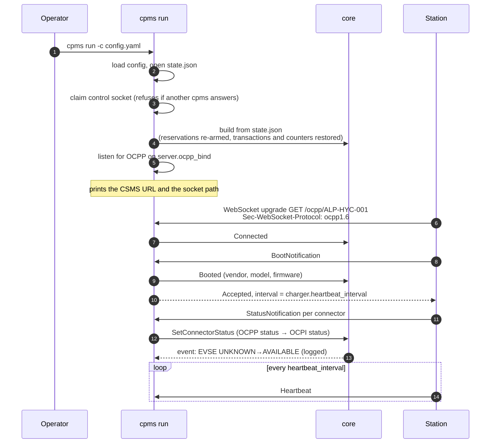
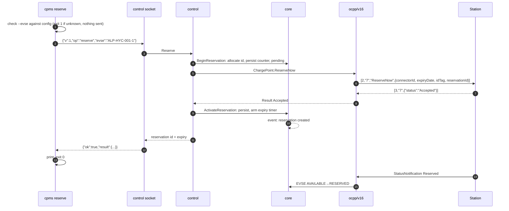
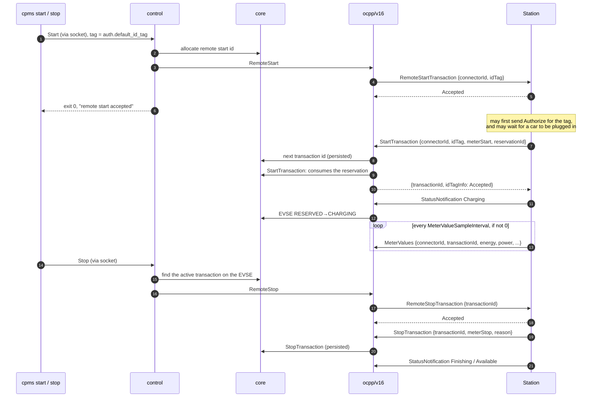
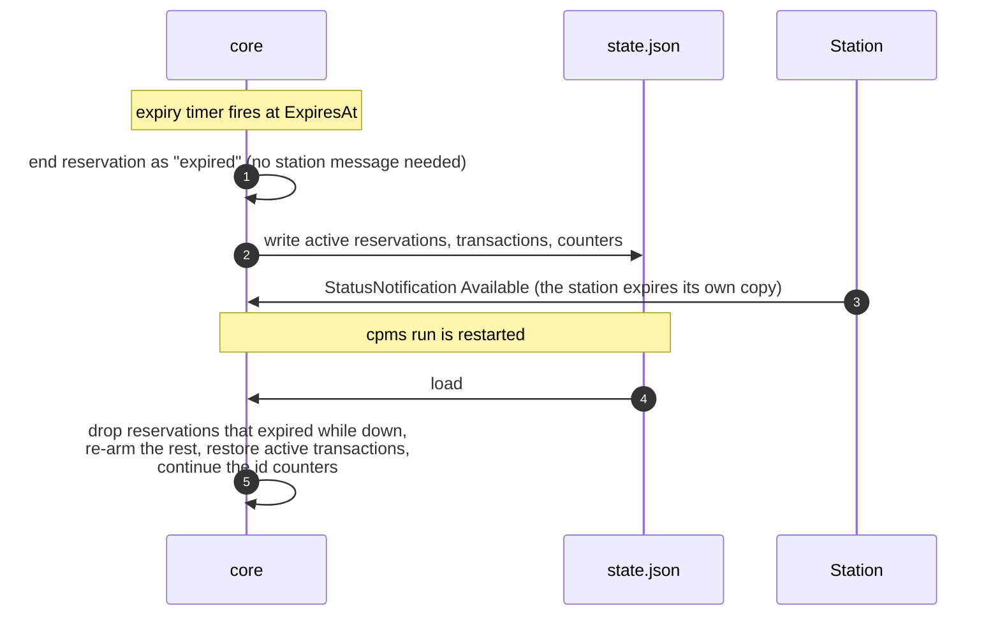
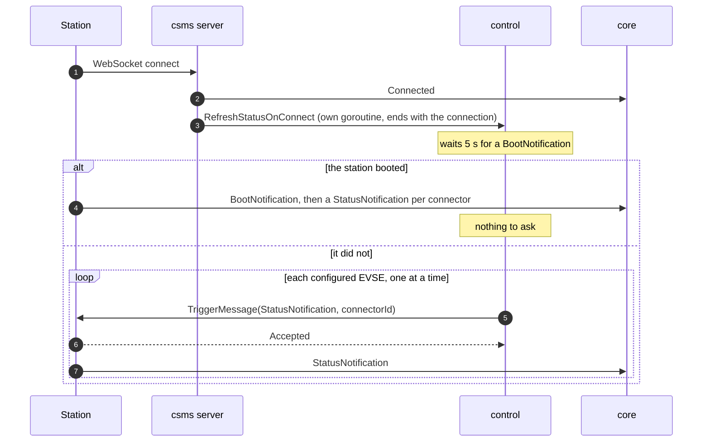
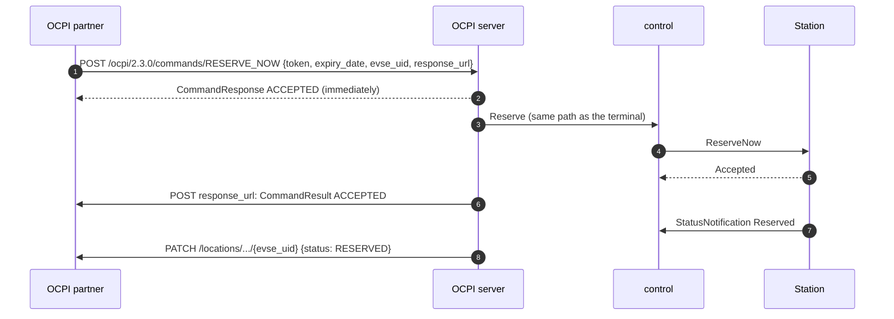

# headless-csms

A terminal charge point management system for a single OCPP charging station.

`cpms` is one static binary that:

- speaks **OCPP 1.6-J** (2.0.1 later) to the station, so you can reserve a connector,
  redeem the reservation with a known RFID tag, stop the session, and unlock the cable;
- exposes a minimal **OCPI 2.3.0 CPO** interface on the LAN — `versions`, `credentials`,
  `locations` (sender) and `commands` (receiver) — so a backend can register, pull static
  location data, and send `RESERVE_NOW` that ends up at the real charger;
- **PATCHes** EVSE status to the registered counterparty whenever it changes, whether the
  change came from the terminal or from someone physically plugging in a car;
- needs no database, no container and no web UI — one hand-edited config file, one binary.

## How the charger connects

This trips people up, so it is worth stating plainly: **in OCPP-J the charger is the
WebSocket client.** It dials us; we do not dial it. Configure the station's CSMS URL as:

```
ws://<host running cpms>:9000/ocpp/<charge point id>
```

`charger.ip` in the config is only used for a reachability pre-check and for display.

## Quickstart

```sh
make build                                   # -> bin/cpms
cp config.example.yaml config.yaml           # then edit it
./bin/cpms config validate -c config.yaml
```

A valid config prints the facts you need to get the station and the counterparty
talking to you:

```
config.yaml is valid.

  Charge point        ALP-HYC-001  (OCPP 1.6)  at 192.168.1.42
  OCPP listener       0.0.0.0:9000
  Station CSMS URL    ws://<this-host>:9000/ocpp/ALP-HYC-001
  Heartbeat timeout   90s
  OCPI listener       0.0.0.0:8080
  OCPI advertised as  http://192.168.1.10:8080/ocpi
  OCPI party          DE*EXA
  Default RFID tag    04A1B2C3D4
  Location            SITE-01 "Example Site", Berlin (DEU) — 2 EVSEs, 2 connectors
  State file          state.json

  EVSE           EVSE ID        OCPP CONNECTOR  CONNECTORS
  ALP-HYC-001-1  DE*EXA*E001*1  1               IEC_62196_T2_COMBO/CABLE/DC 920V 500A
  ALP-HYC-001-2  DE*EXA*E001*2  2               IEC_62196_T2_COMBO/CABLE/DC 920V 500A
```

Then start the CSMS and point the station at the URL it prints:

```sh
./bin/cpms run -c config.yaml
```

```
cpms listening for ALP-HYC-001 on ws://127.0.0.1:9000/ocpp/ALP-HYC-001
OCPI versions endpoint http://192.168.1.10:8080/ocpi/versions (listening on 0.0.0.0:8080)
waiting for the charge point to connect; press Ctrl-C to stop
INFO msg="charge point connected" charge_point=ALP-HYC-001 version=1.6
INFO msg="ALP-HYC-001 booted (Alpitronic HYC300)"
INFO msg="ALP-HYC-001-1 UNKNOWN→CHARGING"
```

`--log-level debug` shows the protocol chatter underneath.

## Testing without the station

A charge point simulator is built into the binary, so the whole thing runs on a laptop.
In a second terminal:

```sh
./bin/cpms simulate charger -c config.yaml
```

With no flags it reads the same config file and points itself at the CSMS `cpms run` is
serving, so the two commands are a working pair out of the box. The station appears in the
first terminal:

```
INFO msg="charge point connected" charge_point=ALP-HYC-001 version=1.6
INFO msg="ALP-HYC-001 booted (Alpitronic HYC300 fw simulator)"
INFO msg="ALP-HYC-001-1 UNKNOWN→AVAILABLE"
INFO msg="ALP-HYC-001-2 UNKNOWN→AVAILABLE"
```

Scenarios make it misbehave on purpose, which is how the unhappy paths get tested:

| `--scenario` | Behaviour |
|---|---|
| `normal` | A cooperative station (default) |
| `reject-reserve` | Refuses every `ReserveNow`, and stops advertising the Reservation feature profile — what a station that cannot reserve actually looks like |
| `occupied` | Answers `ReserveNow` with `Occupied` |
| `slow` | Stalls every answer past the call timeout |
| `unlock-fails` | Refuses to release the cable lock |
| `silent` | Boots, then stops sending anything while still answering pings — a station whose OCPP layer has hung but whose connection is fine. This is what `heartbeat_timeout` exists to catch, and the only way to exercise it by hand |
| `reject-profile` | Answers every `SetChargingProfile` with `Rejected` |
| `offline-tx` | Charges through an outage, end to end. Implies `--reconnect`, and `--meter-interval 1s` unless given. Starts a transaction on connector 1 and waits for the connection to drop (stop `cpms run`, or have a proxy close it). Offline, it lets 3 meter values queue up, stops the transaction, and starts and stops a second one; only then does it redial, and after the boot it delivers the queue |

`--meter-interval 10s` makes a running session send `MeterValues` that often, combined with
any scenario (except `silent`, which still sends nothing). Each sample carries the
transaction id the CSMS assigned and four readings from a car drawing a constant 50 kW:
`Energy.Active.Import.Register` (Wh, rising with power × time), `Power.Active.Import` (W),
`Current.Import` (A) and `SoC` (%, from 20). The car is a 75 kWh battery starting at 20%,
so the register rises strictly for about 72 minutes. Once the battery is full, power and
current drop to 0, the SoC stays at 100 and the register stops rising; the connector then
sends one `StatusNotification` `SuspendedEV`, as a real full car does, and the session runs on
until it is stopped. `StopTransaction`'s `meterStop` is the last streamed register. The default, `0`, streams nothing, and a session
then moves the meter by a flat 1000 Wh as before. The simulator also answers
`ChangeConfiguration`, so a CSMS can move `MeterValueSampleInterval` (and
`HeartbeatInterval`) at run time and read it back with `GetConfiguration`.
`MeterValuesSampledData` reports the four measurands above and is read-only, since the stream
does not follow it. The simulator advertises the SmartCharging profile and reports its
configuration keys (both rate units, stack level 8, 24 periods, 10 profiles), and answers
`SetChargingProfile`, `ClearChargingProfile` and `GetCompositeSchedule` within those limits
(beyond them: `Rejected`). Profiles are kept per connector (0 is the station) and replace
one with the same id, or the same purpose and stack level. A `TxProfile` needs a running
transaction (so a merely reserved connector refuses it) and ends with it; a
`TxDefaultProfile` can be set while the connector is reserved. The limit at any moment is
the highest stack level per purpose, `TxProfile` over `TxDefaultProfile`, capped by the
connector's share of `ChargePointMaxProfile`; the streamed power (and current) is capped at
it, with amperes taken at 400 V. `ChargePointMaxProfile` limits the station's total, so the
simulator splits it evenly between the connectors with a running transaction (a share one
connector leaves unused is not handed to the others), and `GetCompositeSchedule` for
connector 0 reports the station's total. The model is simplified: `Relative` schedules always start "now",
`Recurring` ones are read in their current recurrence only, and `GetCompositeSchedule`
does not convert units (asking in A for profiles in W is `Rejected`). Profiles survive a
reconnect and a `Reset` (errata 3.37), but not a restart of the simulator.

By default the simulator exits when its connection drops. `--reconnect` makes it behave
like a station instead: it redials with backoff (1 s, 2 s, 4 s … capped at 30 s, each wait
shortened by up to a fifth at random), then sends `BootNotification` again and reports the
station and every connector again. (`simulator.Options.ResumeWithoutBoot`, for tests, makes a
redial skip the boot and the status round instead, like the Alpitronic HYC50.) A
`BootNotification` the CSMS rejects after a reconnect still makes it exit non-zero. The
first dial is not retried: a CSMS that cannot be reached at start-up is more likely a
wrong `--csms` than an outage.

While it is offline it keeps charging, as a real station does. Sessions start and stop
locally, the meter keeps streaming, and every transaction message (`StartTransaction`,
`MeterValues`, `StopTransaction`) is queued with the timestamp it was made with. A session
started offline runs under a placeholder id of the simulator's own, which never goes on the
wire and which `TransactionID` does not report: that is 0 until the CSMS has answered the
`StartTransaction`. Once it has, the queued `MeterValues` and `StopTransaction` carry the
CSMS's id instead. Status changes are not queued: the status round after the boot reports where each
connector ended up. After an Accepted boot the queue goes out first, in order, one call at
a time, and a transaction message made while it does joins its end (OCPP 1.6 §3.7). The
status round follows; a meter sample made in the meantime can go out between its
`StatusNotification`s, which §3.7 allows. A message leaves the queue only once the CSMS has
answered it:

| Answer | What happens |
|---|---|
| `CALLRESULT` | Delivered |
| Any `CALLERROR`, or no answer within the call timeout | The CSMS failed to process it, which is what OCPP 1.6 §3.7.1 lets a station skip a message for only if it happens repeatedly: sent again after the backoff, at most 3 times in all (the stand-in for `TransactionMessageAttempts`), then given up. `FormationViolation` and the other codes that blame the message are retried like `InternalError`; the specification makes no exception for them |
| The connection drops | Stays queued, with everything behind it, for the next connection |

A `StartTransaction` that is given up takes the queued messages of its session with it, and
a session started offline that is still running ends locally: the meter stops and the
connector is Available again, which the status round reports. The simulator never sends a
message under the placeholder id, even though the CSMS may have opened the transaction and
only its answers been lost.

A replayed `StartTransaction` that the CSMS answers with an `idTagInfo.status` other than
`Accepted` (cpms does so, with `transactionId` 0, for a tag it does not know) ends a session
that is still running as `StopTransactionOnInvalidId=true` would (§3.5.4): the simulator
sends `StopTransaction` for the id the CSMS gave, even 0, with reason `DeAuthorized`, and
the connector is Available again. A session already stopped offline is delivered as made.

The queue lives in memory: a simulator that is restarted starts with an empty one. Offline
starts are always allowed; `LocalAuthorizeOffline` and `AllowOfflineTxForUnknownId` are not
consulted yet.

A reserved connector refuses a start for any idTag but the reserved one (compared
case-insensitively; `parentIdTag` is not modelled), as OCPP 1.6 §5.13 requires: a local start
returns an error, `RemoteStartTransaction` is answered `Rejected`, and the reservation stays.
The reserved tag's start carries `reservationId`. `--allow-foreign-tag` (`Options.AllowForeignTagOnReservation`)
turns the refusal off, for testing how a CSMS handles it when a station lets another tag
start: the session then begins without `reservationId` and the reservation is dropped.

`--connectors`, `--id`, `--csms`, `--tag`, `--vendor` and `--model` override the config
when you want to point it somewhere else or fake a different station.

An invalid config exits 1 and names every problem by its field path, all in one pass:

```
config.yaml is not valid:

  auth.default_id_tag: "04A1 B2C3" is not a valid OCPP idTag; want 1-20 printable ASCII characters without spaces
  charger.id: is required
  location.evses[1].ocpp_connector_id: 1 is already mapped by location.evses[0]

3 problems found.
```

## Driving the station

While `cpms run` is serving, one-shot commands in another terminal act on the station
through it. With the simulator from the previous section in a second terminal, a third one
gives you the whole flow this tool exists for: reserve, redeem with the RFID tag, stop.

```
$ cpms reserve --evse ALP-HYC-001-1
ALP-HYC-001-1 reserved for 04A1B2C3D4 until 14:43:30 (reservation 1)

$ cpms status
ALP-HYC-001  online  Alpitronic HYC300 fw simulator  last seen 14:28:30

EVSE           STATUS     RESERVATION                   TRANSACTION
ALP-HYC-001-1  RESERVED   #1 04A1B2C3D4 until 14:43:30  -
ALP-HYC-001-2  AVAILABLE  -                             -

OCPI  not registered

$ cpms start --evse ALP-HYC-001-1
ALP-HYC-001-1 remote start accepted

$ cpms status
...
ALP-HYC-001-1  CHARGING   -            1 04A1B2C3D4 since 14:28:32

$ cpms stop --evse ALP-HYC-001-1
ALP-HYC-001-1 remote stop accepted
```

| Command | Does |
|---|---|
| `cpms reserve [--evse UID] [--tag TAG] [--expires 15m]` | Holds an EVSE for a tag. The tag defaults to `auth.default_id_tag`, the length to 15 minutes. |
| `cpms cancel [--evse UID]` | Releases the reservation on an EVSE |
| `cpms start [--evse UID] [--tag TAG]` | Asks the station to start a session. It returns once the station accepts; the session shows up in `status` when the station reports it. |
| `cpms stop [--evse UID] [--tx ID]` | Stops the session running on an EVSE. `--tx` names it; it is only needed when cpms holds two sessions on one EVSE (see below). |
| `cpms unlock [--evse UID]` | Releases the cable lock |
| `cpms status [--json]` | The station, per EVSE its status, reservation and session, and the OCPI registration. `--json` is a stable format for scripts. |
| `cpms ocpi unregister` | Forgets the OCPI registration so the partner can register again; see [Registering with an OCPI partner](#registering-with-an-ocpi-partner). |
| `cpms probe [--json] [--raw]` | What the station supports and how it is set up; see [Probing the station](#probing-the-station). |
| `cpms config set <key> <value>` | Sets one of the **station's** OCPP configuration keys (`ChangeConfiguration`); `config.yaml` is not touched. See [Power, current and the station's configuration](#power-current-and-the-stations-configuration). |
| `cpms limit set\|clear\|show`, `cpms profile set` | Charging limits (OCPP Smart Charging); see [Smart charging](#smart-charging). |

`--evse` takes the EVSE `uid` from config, and may be left out when only one EVSE is
configured. A typo is caught from config before anything is sent, and the error lists the
valid uids.

**One session per EVSE.** A connector runs one session at a time, so when a station starts a
new one on a connector where cpms still holds one, cpms ends the old one itself: stopped at the
new one's start, reason `Other`, with a warning in the log. Stations do this when they come back
from a restart having forgotten their session, and never send its `StopTransaction`; a late
one is logged as a stop for an unknown transaction. A `state.json` from a cpms before this can
still hold two sessions on one EVSE. `cpms stop` and `cpms limit set --purpose tx` then refuse to
guess (exit 1) and list both ids; `--tx ID` chooses, and must name a session active on that EVSE
(exit 9 otherwise).

**Output streams:** reports go to stdout, so `cpms probe --json | jq` works: `status`,
`probe` and their `--json`, `config validate`, the command confirmations, `version`, the
startup and shutdown lines of `run`, and the banner of `simulate charger`. A report's own
warnings, such as probe's `!` checks and its JSON `warnings`, are part of it and go to
stdout too. Logs, validation problems and `cpms: …` errors go to stderr.

**Exit codes** are stable, so scripts can branch on them:

| Code | Meaning |
|---|---|
| 0 | Success |
| 1 | Usage, config, or unexpected error (including an unknown `--evse`) |
| 2 | `cpms run` is not reachable |
| 3 | The charge point is not connected to cpms |
| 4 | The station rejected the command (`cpms config set`: also `NotSupported`, an unknown key) |
| 5 | The station is occupied |
| 6 | The station is faulted or unavailable |
| 7 | The station did not answer within `charger.call_timeout` |
| 8 | Unlock failed, or the station does not support the command |
| 9 | Refused by cpms before sending: already reserved (including while the cancel of a timed-out reservation is in flight), no reservation to cancel, nothing to stop, a `tx` limit with no session running (without `--force`), shutting down. `cpms ocpi unregister`: nothing is registered, or a registration is still in progress (nothing was changed; try again) |
| 10 | `cpms probe`: the station reported that it lacks a capability cpms requires (one it merely did not report is not an error) |
| 11 | `cpms limit` / `cpms profile`: the station does not support this charging profile or request (`NotSupported`, or a `NotImplemented`/`NotSupported` CALLERROR) |

### Power, current and the station's configuration

`cpms status` shows the newest meter reading per EVSE in a `METER` column: what the
station draws, the most it offers the car (the limit it applies, which a charging profile
changes), and how old the reading is.

```
EVSE           STATUS    RESERVATION  TRANSACTION                   METER
ALP-HYC-001-1  CHARGING  -            1 04A1B2C3D4 since 14:28:32  50.0 kW 125.0 A, offered 150.0 kW, 3s ago
```

`cpms status --json` has the same as fields on each EVSE, all omitted when absent:
`power_w` (W), `current_a` (A), `power_offered_w` (W), `current_offered_a` (A),
`reading_at` (when the station took the newest `MeterValues`), and per value when it was
taken: `power_at`, `current_at`, `power_offered_at`, `current_offered_at`. They come from
the newest value of `MeterValues`: `Power.Active.Import`, `Current.Import`,
`Power.Offered`, `Current.Offered`. Stations interleave messages with different
measurands (clock-aligned energy between periodic samples, for instance), so a message
without a value keeps the one before; when the values then differ in age, the `METER`
column gives each its own, as in `50.0 kW 125.0 A 3s ago, offered 22.0 kW 1m0s ago`.
When a station reports only phases, power is the sum of the phases and current the highest
phase. `kW` is converted to W; a value cpms cannot read is logged and left out. The reading
is kept in memory only: it is not in `state.json`, and it is dropped when the session on the
EVSE stops or the station disconnects. A `MeterValues` for a transaction that is not running
on that EVSE (the stopped session's last values, arriving late or replayed from the
station's offline queue) is logged but not kept. One without a transaction is kept: that is
clock-aligned data, which a station also sends for an idle or Reserved connector.

A `MeterValues` for connector 0 is the station as a whole, never an EVSE. `cpms status`
shows it on the station's line, as in `ALP-HYC-001  online  …  meter offered 50.0 kW, 3s
ago`, and `--json` as `charge_point.meter` with the same fields as an EVSE's reading. It is
dropped when the station disconnects.

A station only reports the measurands listed in its `MeterValuesSampledData` key, which
`cpms probe --raw` shows. An Alpitronic HYC50 reports only
`Energy.Active.Import.Register` out of the box, so turn the rest on once:

```
$ cpms config set MeterValuesSampledData \
    Energy.Active.Import.Register,Power.Active.Import,Power.Offered,Current.Import,Current.Offered
MeterValuesSampledData set to "Energy.Active.Import.Register,Power.Active.Import,..." on the station (Accepted)
```

Sampled data only flows during a session (OCPP 1.6 §9.1, `MeterValueSampleInterval`: from
the start of the transaction). On a connector that is `Available` or `Reserved` the `METER`
column therefore stays `-` however `MeterValuesSampledData` is set; that does not mean the
station ignored a charging profile. Outside a session the offered limit only arrives as
clock-aligned data: `MeterValuesAlignedData` lists the measurands, sent every
`ClockAlignedDataInterval` seconds, where `0` (the HYC50's setting) means none at all. To
see the limit on a Reserved HYC50 connector, for instance while testing a charging profile:

```
$ cpms config set MeterValuesAlignedData Power.Offered,Current.Offered
$ cpms config set ClockAlignedDataInterval 60
```

The HYC50 takes up to 7 measurands there (`MeterValuesAlignedDataMaxLength`); add
`Energy.Active.Import.Register` if you want energy too. Per the spec an aligned value is sent
at the end of each interval, stamped with the interval's start time, and may be an average
over it. With 60 s its age therefore reads between one and two minutes, and a changed limit
can take an interval to show fully.
Setting the interval back to `0` turns aligned data off. The other way to read the limit is
to start a session: the `Transaction.Begin` and periodic samples carry `Power.Offered` once
`MeterValuesSampledData` lists it.

`cpms config set` changes the station, which keeps the value; it does not change
`config.yaml`, and cpms does not set it again after a reboot. It exits 0 when the station
answers `Accepted`, and also for `RebootRequired`, which is printed as a `warning:` on
stderr because the value applies only after the station restarts. `Rejected` (a read-only
key, or a value the station does not take) and `NotSupported` (a key the station does not
know) exit 4. The other exit codes are as above. The simulator always streams power and
current, and reports `MeterValuesSampledData` as read-only, so it answers `Rejected` there;
try `HeartbeatInterval` or `ConnectionTimeOut` against it instead.

`cpms ocpi unregister` exits 0 once the registration is forgotten, even if the partner could
not be told: a failed `DELETE` to the partner is reported as a `warning:` line on stderr, not
as a failure, because the unregistration itself happened.

**How it works.** `cpms run` listens on a Unix socket, `cpms.sock` next to the state file by
default (`--socket` overrides it; use the same value for `run` and the commands). The socket
is `0600` and removed on shutdown. It also stops a second `cpms run` on the same state: the
second one finds the first answering and exits with "another cpms is already running". A
socket left behind by a `cpms run` that was killed is detected and replaced.

Socket paths are limited to 103 bytes, a kernel limit on macOS. If the default path next to
the state file is longer than that, cpms falls back to a short path in the temp directory
(`cpms-<hash of the state path>.sock`), which `run` and the commands both derive on their
own; `cpms run` prints the path it uses. A `--socket` you give explicitly is used as is.

## Probing the station

The reservation path assumes the station implements OCPP reservations, and not every unit
does. `cpms probe` is the first thing to run against a new station: it asks for the station's
whole configuration and reports what cpms can rely on. It is read-only and changes nothing
on the station.

```
$ cpms probe
ALP-HYC-001  OCPP 1.6
  Alpitronic HYC300, firmware simulator

Features
  Core                ✓  required  start, stop, unlock
  Reservation         ✓  required  reserve, cancel, OCPI RESERVE_NOW
  RemoteTrigger       ✓  optional  status refresh on demand
  SmartCharging       ✓  optional  limit, profile
  FirmwareManagement  ✓            not used by cpms

Settings
  ReserveConnectorZeroSupported            false                                                                 whether the whole station can be reserved at once; cpms always reserves one EVSE, so this is informational
  AuthorizeRemoteTxRequests                false                                                                 if true, the station asks cpms to Authorize the tag of a remote start; cpms accepts only auth.default_id_tag
  LocalAuthListEnabled                     false                                                                 if true, a whitelist held on the station can let tags charge without asking cpms
  LocalPreAuthorize                        false                                                                 if true, the station starts at once for tags it knows locally, before cpms answers
  LocalAuthorizeOffline                    false                                                                 if true, the station lets tags it knows locally charge while cpms is unreachable
  NumberOfConnectors                       2                                                                     how many connectors the station has; checked against the EVSEs in config
  HeartbeatInterval                        60                                                                    seconds between heartbeats; cpms sets it at boot from charger.heartbeat_interval
  ConnectionTimeOut                        60                                                                    seconds the station waits for a cable after a remote start or a presented tag
  MeterValueSampleInterval                 0                                                                     seconds between meter values during a session; 0 means none are sent
  MeterValuesSampledData                   Energy.Active.Import.Register,Power.Active.Import,Current.Import,SoC  measurands sent during a session; Power.Offered and Current.Offered carry a charging limit, Power.Active.Import and Current.Import its effect; entries may end in a phase, as in Current.Import.L1
  ChargingScheduleAllowedChargingRateUnit  Current,Power                                                         units a charging schedule may use (Current, Power or both); decides whether a limit can be set in kW or in A
  ChargeProfileMaxStackLevel               8                                                                     highest stack level the station accepts for a charging profile
  ChargingScheduleMaxPeriods               24                                                                    most periods the station accepts in one charging schedule
  MaxChargingProfilesInstalled             10                                                                    how many charging profiles the station keeps installed at once

Checks
  ok  2 connectors, matching the 2 EVSEs in config
  ok  heartbeat every 60s, as charger.heartbeat_interval says

Every capability cpms requires is present.
```

A station without the Reservation profile, here `cpms simulate charger --scenario
reject-reserve`, exits **10**:

```
Features
  Core                ✓  required  start, stop, unlock
  Reservation         ✗  required  reserve, cancel, OCPI RESERVE_NOW
  ...

Reservation is missing: OCPI RESERVE_NOW cannot be passed on to the station, so cpms would have to hold reservations itself.
cpms: the station lacks 1 capability that cpms requires: reservation
```

- **Features** are named as the station names them (1.6 feature profiles). Core and
  Reservation are required; without RemoteTrigger cpms only learns about status changes when
  the station reports them by itself. SmartCharging is optional: without it `cpms limit` and
  `cpms profile` are refused, but nothing else is affected, so its absence never fails the
  probe.
- **Missing is not the same as not reported.** A capability the station reports as absent
  is *missing*, and makes the command exit 10. A required capability the station says
  nothing about (`?`) is *unconfirmed*: a warning that suggests trying it, such as
  `cpms reserve`, with exit 0. Some stations list no `SupportedFeatureProfiles` at all;
  Core is mandatory in OCPP 1.6, so it is then assumed present, and the probe says so.
- **A full profile list is not the whole story.** A station can list at most
  `SupportedFeatureProfilesMaxLength` profiles. When its list is that long, a profile
  missing from it may only have been cut off (the Alpitronic HYC50 lists five and leaves out
  Reservation, which it supports), so it is *unconfirmed*, not missing, and the probe says
  why. Core, which is mandatory, is still assumed present. A shorter list, or no usable
  max length, is taken at its word. This is a workaround for real stations, not spec: OCPP
  1.6 errata 3.81 withdraws `SupportedFeatureProfilesMaxLength`. The price is that a
  station with a complete, exactly full list that really lacks a profile shows it as
  unconfirmed instead of missing.
- **Settings** are the keys that change how the station behaves towards cpms. A key the
  station does not report shows as `not reported`; that is not an error. The last five are
  for charging limits: `ChargingScheduleAllowedChargingRateUnit` says whether a limit can be
  given in power (`Power`), in current (`Current`) or both, and `MeterValuesSampledData`
  says whether a limit can be seen in the meter values: `Power.Offered` and `Current.Offered`
  carry the limit itself, `Power.Active.Import` and `Current.Import` its effect, and an entry
  may end in a phase, as in `Current.Import.L1`.
- **Checks** compare the station with config. A connector count that differs from the EVSEs
  in config, or a heartbeat interval other than `charger.heartbeat_interval`, is a warning
  (`!`); it does not change the exit code.
- `--raw` adds every key the station reported, with whether it is read-only. `--json` prints
  the whole report, including every key, with `ok`, `missing`, `unconfirmed` and `warnings`
  for scripts. `ok` is false only when `missing` is not empty. A feature's `grants` lists the
  capabilities it provides, whether or not cpms uses them (FirmwareManagement grants
  nothing cpms uses); what cpms requires is what `missing` and `unconfirmed` are computed
  from. A feature's `note` says why its support is what it is when the station's answer
  alone would mislead, such as a full profile list; it is empty otherwise.
If the station is not connected, `cpms probe` exits 3 and prints the CSMS URL to configure on
the station, the same one `cpms config validate` prints, plus when and why it last
disconnected.

### Tested hardware

Alpitronic HYC50, firmware `hyc_v3.0.1`, OCPP 1.6-J. It dials `<CSMS URL>/ocpp/<identity>`,
adding its own identity, and connects over plain `ws://` with security profile 0. What it does
that cpms has to expect:

| Topic | Seen on the station | What cpms does |
|---|---|---|
| Feature profiles | `SupportedFeatureProfiles` lists 5 of its 6 profiles (`SupportedFeatureProfilesMaxLength` = 5) and leaves out Reservation | A missing profile on a full list is *unconfirmed*, not missing. `ReserveNow` and `CancelReservation` work, and the connector goes Reserved. |
| Reconnect | After a reconnect without a reboot, it sends no StatusNotification | Asks for every EVSE's status with TriggerMessage after a short grace |
| Status timing | Reports a change only after `MinimumStatusDuration` (10 s) | Nothing; expect the delay |
| RFID | A tag presented with no remote command is sent as `Authorize`, as the UID in uppercase hex without separators. After `Accepted` it asks for the cable. | Answers `Authorize`; tags compare without regard to case |
| Remote start | Accepted, then it asks for the cable and waits `ConnectionTimeOut` (120 s) | Nothing |
| Meter values | `MeterValuesSampledData` is energy only, and `ClockAlignedDataInterval` is 0 (no aligned data) | Turn power and offered values on with `cpms config set`; see [Power, current and the station's configuration](#power-current-and-the-stations-configuration) |
| Smart Charging | Rate units `Power,Current`, stack levels up to 9, 10 periods, 100 profiles installed | `cpms limit` stays within these |

Not yet checked on the station: start, stop and unlock with a car connected, which
connector id is which outlet, whether connector 0 reports a status, the heartbeat spacing,
timestamps, the station's own offline behaviour, meter values during a session, and charging
profiles while a connector is Reserved. Results go in #11.

## Smart charging

`cpms limit` and `cpms profile` set OCPP 1.6 charging profiles: limits on how much power or
current an EVSE, or the whole station, may draw. The motivating case is an Alpitronic
HYC50: can a limit be set while a connector is **reserved**, and does it hold once the
reservation is redeemed?

| Command | Does |
|---|---|
| `cpms limit set [--evse UID \| --station] (--kw N \| --amps N) [--purpose P] [--stack N] [--for 1h] [--force \| --tx ID]` | Installs a one-period profile from now on. `--kw` is sent in W, `--amps` per phase; exactly one is required. |
| `cpms limit clear [--evse UID \| --station] (--id N \| --purpose P \| --all)` | `ClearChargingProfile`. `--purpose` and `--all` clear on every EVSE and the station unless `--evse` or `--station` narrows them. |
| `cpms limit show [--evse UID \| --station] [--duration 1h] [--unit W\|A]` | `GetCompositeSchedule`: the limits the station will actually apply, all profiles combined, as a period table. |
| `cpms profile set [--evse UID \| --station] -f profile.json` | Installs a full profile from a file (shape below). |

**Purposes** (`--purpose`, default `tx-default`):

- `tx-default` (`TxDefaultProfile`) applies to sessions that start after it is set. It is the
  one that can be set while an EVSE is reserved and idle.
- `tx` (`TxProfile`) applies to the running session and overrides `tx-default`; it ends with
  the session. cpms fills in the transaction id of the one session on the EVSE, or the one
  `--tx` names. With no session
  running cpms refuses it (exit 9) unless `--force`, which sends it without a transaction id to
  see what the station says (the spec expects `Rejected`).
- `station-max` (`ChargePointMaxProfile`) caps the whole station; it needs `--station`, and
  `--station` takes nothing else.

Within one purpose the highest `--stack` level wins. `--for 1h` sets the schedule's
`duration` and the profile's `validTo`; without it the limit holds until cleared. cpms
allocates the profile ids (never reused, also across restarts), and a profile with the same
id, or the same EVSE, purpose and stack level, replaces the one before it, at the station and
in cpms's records.

**What cpms remembers.** A profile is recorded in `state.json` only once the station answers
`Accepted`, and `cpms status` lists the records per EVSE and for the station, marked *as sent*:
the station is the source of truth and may have dropped them, for instance on a reboot. `cpms
limit show` asks it what it applies. A `tx` record goes when its session stops; one sent with `--force` and no
session has no transaction id, and goes when the next session on its EVSE stops. A clear the
station answers `Unknown` (it holds no such profile) drops the matching records too.
`status --json` carries them as `charging_profiles`, on `charge_point` for the station and on
each EVSE: `id`, `purpose`, `stack_level`, `unit`, `periods` (`start_s`, `limit`, `phases`),
`valid_from`, `valid_to`, `transaction_id`, `set_at` and `source`.

**Answers and exit codes.** `Accepted` exits 0. `Rejected` exits 4: the station will not take
this profile (a `tx` one without a session, a unit it does not allow, a stack level or period
count beyond its limits, too many profiles installed). `NotSupported`, or a `NotImplemented` /
`NotSupported` CALLERROR, exits 11: the station does not support this request, which for `limit show`
(`GetCompositeSchedule`) says nothing about whether it takes profiles. A clear answered `Unknown` exits 4 with "holds no matching charging profile". No
answer within `charger.call_timeout` exits 7. When a profile went out but no answer came
back (exit 7, or 3 if the connection dropped), the station may hold it although cpms records
nothing; the message names the id it was sent with: check with `cpms limit show` and remove
it with `cpms limit clear --id N`. Mistakes in the flags or the file exit 1 before
anything is sent.

**Profile file** for `cpms profile set -f`. The id is not part of it; cpms allocates one.

```json
{
  "purpose": "tx-default",
  "stack_level": 1,
  "kind": "absolute",
  "valid_from": "2026-11-17T08:00:00Z",
  "valid_to": "2026-11-17T18:00:00Z",
  "schedule": {
    "unit": "W",
    "start": "2026-11-17T08:00:00Z",
    "duration_s": 36000,
    "min_rate": 4000,
    "periods": [
      {"start_s": 0, "limit": 22000},
      {"start_s": 3600, "limit": 11000, "phases": 3}
    ]
  }
}
```

`purpose` is `tx-default`, `station-max` or `tx` (then optionally `transaction_id`); `kind` is
`absolute` (default), `relative` or `recurring` (then `recurrency`: `daily` or `weekly`, and a
`start`); `unit` is `W` or `A`. Only `purpose`, `schedule.unit` and `schedule.periods` are
required. Periods start at 0 and increase; limits take at most one decimal place. Unknown
fields are refused.

### Runbook: a limit while reserved, on an Alpitronic HYC50

The HYC50 reports `ChargingScheduleAllowedChargingRateUnit=Power,Current`,
`ChargeProfileMaxStackLevel=9`, `ChargingScheduleMaxPeriods=10` and
`MaxChargingProfilesInstalled=100`. Its `SupportedFeatureProfiles` is cut short at five
entries, so `cpms probe` may show SmartCharging as `?` although the station supports it: go by
the four keys above. `cpms run` is running, the station is connected, and one EVSE is
configured (otherwise add `--evse`). Use the RFID card you will charge with as `--tag`.

0. **Turn on the readings.** The limit is checked on the meter: the `METER` column of `cpms
   status`, or `power_w` and `power_offered_w` in `cpms status --json` (see [Power, current
   and the station's configuration](#power-current-and-the-stations-configuration)). First
   `cpms probe --raw` and **note the original values** of `MeterValuesSampledData`,
   `MeterValuesAlignedData` and `ClockAlignedDataInterval`: the last step puts them back.
   Then:

   ```
   cpms config set MeterValuesSampledData Energy.Active.Import.Register,Power.Active.Import,Power.Offered,Current.Import,Current.Offered
   cpms config set MeterValuesAlignedData Power.Offered,Current.Offered
   cpms config set ClockAlignedDataInterval 60
   ```

   The sampled data shows the power drawn and offered during a session; the aligned pair
   is the only reading on a `Reserved` connector (step 4), where no session runs. The HYC50
   may send aligned values for connector 0 too: that is the station's own meter, shown on
   the first line of `cpms status` after `meter` (`charge_point.meter` in `--json`), not as
   an EVSE. Read the limit from the EVSE row.
1. **Check the station.** `cpms probe`: the four keys above, and SmartCharging ✓ or `?`.
   `cpms limit show` should answer (exit 0). Exit 11 means only that the station does not
   answer `GetCompositeSchedule`: carry on with step 3, whose exit 11 is the real
   no-Smart-Charging signal, and read the limit from the meter instead of `limit show`.
2. **Reserve.** `cpms reserve --tag <card> --expires 30m`. `cpms status` shows `RESERVED`.
3. **Set a limit while reserved.** `cpms limit set --kw 20`.
   - exit 0, `Accepted`: the station took a TxDefault on a reserved connector. `cpms status`
     still shows `RESERVED` and lists `#1 tx-default stack 0, 20.0 kW` as sent.
   - exit 4, `Rejected`: it refuses profiles while reserved (or in W: try `--amps 32`).
   - exit 11: no Smart Charging.
4. **Ask what it applies.** `cpms limit show`: a period at `20.0 kW`. No period, or a higher
   one, means it accepted the profile but does not (yet) apply it to this connector.
   Cross-check on the meter: within one to two aligned intervals `cpms status` shows `offered
   20.0 kW` in the `METER` column (`power_offered_w` 20000 in `--json`) while still
   `RESERVED`. No offered value at all means the station sends no aligned data for this
   connector; that is not a finding about the limit.
5. **Negative test.** `cpms limit set --purpose tx --kw 15 --force`: expected exit 4,
   `Rejected` (no session to bind it to). `Accepted` is worth noting: the station then holds a
   TxProfile without a session, which would cap the session in step 7 at 15 kW and hide
   whether the TxDefault applies. **Clear it now, before step 6:** `cpms limit clear --purpose
   tx`, then `cpms limit show` shows the 20.0 kW of step 3 again, not 15.0 kW.
6. **A station cap leaves the reservation alone.** `cpms limit set --station --purpose
   station-max --kw 30`, then `cpms status`: still `RESERVED`, reservation unchanged.
7. **Redeem.** Plug in the car and present the card (or `cpms start --tag <card>`).
   `cpms status` shows `CHARGING` with the session, and the reservation gone. Wait for a
   sampled reading in the `METER` column: the power drawn stays at or below 20 kW
   (`power_w` ≤ 20000) and the offered power reads 20.0 kW (`power_offered_w` 20000). If it
   draws or offers more than 20 kW, the station accepted the TxDefault but did not apply it
   to the session that redeemed the reservation, which is the finding.
8. **Tighten during the session.** `cpms limit set --purpose tx --kw 10`: exit 0; within a
   `MeterValueSampleInterval` the `METER` column shows `offered 10.0 kW` and the power drawn
   falls to 10 kW or below (`power_offered_w` 10000, `power_w` ≤ 10000), and `cpms limit show`
   shows 10.0 kW.
9. **Stop and clear.** `cpms stop`, then `cpms status`: the `tx` record is gone with the
   session, the `tx-default` and `station-max` remain. `cpms limit clear --all` removes
   everything (exit 0; exit 4 with `Unknown` means the station had already dropped them), and
   `cpms limit show` shows no limit.
10. **Expiry with a TxDefault set.** `cpms reserve --expires 2m`, `cpms limit set --kw 20`,
    let the reservation expire (or `cpms cancel`), then `cpms limit show`: the TxDefault
    should survive the reservation ending.
11. **Units.** Repeat step 3 in the other unit (`--amps 32` after `--kw`); the HYC50 allows
    both, so both should be `Accepted`.
12. **Clean up. Mandatory, also after a failed or aborted run.** The HYC50 keeps charging
    profiles across reboots, so a limit left behind caps every later session on the
    connector, and nothing in `cpms status` points to it once cpms has forgotten it.
    - `cpms limit clear --all` (exit 0; exit 4 with `Unknown` means nothing was left), then
      `cpms limit show`: no limit. Do not stop until it says so.
    - `cpms cancel` if a reservation is still held.
    - Put back the meter settings from step 0, with the originals you noted from `cpms probe
      --raw`: `cpms config set ClockAlignedDataInterval 0` (or its original),
      `cpms config set MeterValuesAlignedData <original>` and
      `cpms config set MeterValuesSampledData <original>`. Check with `cpms probe --raw`.

The simulator runs the same sequence: `cpms simulate charger --meter-interval 5s` caps its
50 kW at the active limit, and `--scenario reject-profile` answers every profile `Rejected`.

## OCPI

`cpms run` also serves OCPI 2.3.0 on `server.ocpi_bind`, and prints the versions URL next
to the OCPP line:

```
cpms listening for ALP-HYC-001 on ws://127.0.0.1:9000/ocpp/ALP-HYC-001
OCPI versions endpoint http://192.168.1.10:8080/ocpi/versions (listening on 0.0.0.0:8080)
```

The versions URL is `ocpi.public_base_url` plus `/versions`. That URL, together with
`ocpi.token_a`, is what the counterparty gets out of band. The **path** of
`public_base_url` is also where cpms serves: `http://192.168.1.10:8080/ocpi` serves under
`/ocpi`, so what is advertised and what is served cannot disagree. Its host is what the
counterparty dials, which is why it is set separately from `ocpi_bind`.

Every request needs `Authorization: Token <base64 of the token>`: standard, padded Base64
(RFC 4648 §4), as OCPI requires since 2.2-d2. A raw, unencoded token is refused like any
unknown one. Encode with `printf '%s'`, not `echo`, or the newline becomes part of the token, and strip the
line breaks GNU `base64` adds every 76 columns (tokens of 58 bytes or more), or the header
breaks on Linux:

```sh
TOKEN_A=change-me-token-a   # ocpi.token_a from your config
curl -s -H "Authorization: Token $(printf '%s' "$TOKEN_A" | base64 | tr -d '\n')" \
  http://127.0.0.1:8080/ocpi/versions
```

```json
{"data":[{"version":"2.3.0","url":"http://192.168.1.10:8080/ocpi/2.3.0"}],"status_code":1000,"status_message":"Success","timestamp":"2026-10-21T20:15:04Z"}
```

`GET .../2.3.0` lists the modules: `credentials` (see
[Registering with an OCPI partner](#registering-with-an-ocpi-partner)) and `locations` as
`SENDER`. Before registration only `TOKEN_A` is accepted, and only for versions and
credentials. After it, only `TOKEN_C`.

### Locations

`locations` serves the one configured Location (static data from `location:` in config)
with each EVSE's live status from the station. It needs module access: `TOKEN_C`, once the
counterparty has registered. Before that every token gets HTTP 401.

```sh
TOKEN_C=change-me-token-c   # ocpi.token_c from your config
auth="Authorization: Token $(printf '%s' "$TOKEN_C" | base64 | tr -d '\n')"
curl -s -H "$auth" http://127.0.0.1:8080/ocpi/2.3.0/locations                    # the list
curl -s -H "$auth" http://127.0.0.1:8080/ocpi/2.3.0/locations/SITE-01            # one Location
curl -s -H "$auth" http://127.0.0.1:8080/ocpi/2.3.0/locations/SITE-01/ALP-HYC-001-1      # one EVSE
curl -s -H "$auth" http://127.0.0.1:8080/ocpi/2.3.0/locations/SITE-01/ALP-HYC-001-1/1    # one Connector
```

- **Status** is the station's own, as core holds it: `UNKNOWN` while the station is
  offline, and a station-wide fault or unavailability on connector 0 overrides every EVSE.
  cpms's reservation records never override it. A reservation whose `ReserveNow` got no
  answer (being cancelled) shows whatever the station reports: if it does hold it, it says
  `Reserved` itself.
- **`last_updated`**: a Connector's is the config file's modification time, read once at
  startup; an EVSE's is the later of that and its last status change; the Location's is the
  latest of all. Status repeats from the station that change nothing do not move it.
- **Capabilities** per EVSE: `REMOTE_START_STOP_CAPABLE`; `UNLOCK_CAPABLE` only when every
  connector is a `SOCKET` (a tethered cable has no lock to release, OCPP 1.6 §5.18); and
  `RESERVABLE` unless the EVSE has `reservable: false`.
- **The list** is paginated: `offset`, `limit` (default and maximum 100), `date_from`
  (inclusive) and `date_to` (exclusive) on the Location's `last_updated`. Answers carry
  `X-Total-Count`, `X-Limit` (the limit applied, not the number returned) and, when more
  pages exist, `Link: <…>; rel="next"` with the filters kept.
- An unknown location, EVSE or connector is HTTP 404 with `status_code` 2003. A malformed
  `date_from`/`date_to`, a negative `offset` or a `limit` below 1 is HTTP 400 with 2001.
  Ids match without regard to case, as OCPI's CiString requires.

- A missing header, bad Base64, and an unknown token all get the same HTTP 401, so the
  answer gives no hint which one it was.
- Every answer is an OCPI envelope with a UTC `timestamp` ending in `Z`, and carries
  `X-Request-ID` and `X-Correlation-ID`: the ones the request sent, or fresh UUIDs.
- Handlers get both ids in the request context (`ocpi.RequestID`, `ocpi.CorrelationID`), and
  the debug log line carries both.
- The HTTP server times out reading headers after 10 s, reading a whole request after 30 s,
  writing a response after 60 s and an idle keep-alive connection after 120 s. On shutdown the
  server cancels its lifetime context, which every request context and background delivery
  hangs off, so handlers stop with it.
- Request bodies are capped at 1 MiB. JSON that does not parse gets HTTP 400 with
  `status_code` 2001; unknown fields are accepted, as OCPI requires.
- `--log-level debug` logs one line per request (method, path, status, duration, request
  id, correlation id). Tokens are never logged.

There is no TLS: this is a LAN tool, by decision.

### Registering with an OCPI partner

OCPI needs a credentials handshake before the partner can use Locations or Commands. cpms is
the **Receiver** of it: the partner starts it, cpms answers.

1. **Send the partner, out of band**, the versions URL that `cpms run` prints
   (`ocpi.public_base_url` + `/versions`) and `ocpi.token_a`.
2. The partner reads our versions with `TOKEN_A`, makes up its own token (`TOKEN_B`) and
   `POST`s its credentials (that token plus its versions URL) to `{public_base_url}/2.3.0/credentials`.
3. During that POST, cpms calls the partner's versions and 2.3.0 version details **with
   `TOKEN_B`**, and stores the token, the endpoints and the partner's roles in `state.json`.
   Nothing is stored unless both calls succeed. Each call gives up after 10 s.
4. cpms answers with its own credentials: `ocpi.token_c`, our versions URL, and one `CPO` role
   with `ocpi.country_code`, `ocpi.party_id` and `ocpi.business_name` (or `location.name`).
   Config validation holds whichever of the two is used to OCPI's 100 characters.
5. From then on the partner uses `TOKEN_C`, and `TOKEN_A` gets HTTP 401. The registration
   survives a restart.

What the partner can get back:

| Answer | Means |
|---|---|
| HTTP 200, `1000` | Registered. |
| HTTP 200, `3001` | cpms could not use the partner's API: unreachable, timed out, a non-2xx answer, or a status code other than 1000. Nothing is stored. |
| HTTP 200, `3002` | The partner offers no OCPI 2.3.0. Nothing is stored. |
| HTTP 400, `2001` | The credentials are invalid: a missing token or one that is not 1-64 printable ASCII characters without whitespace, a URL that is not absolute, or no roles. |
| HTTP 405 | `POST` while registered, or `PUT`/`DELETE` while not (as the spec says). |
| HTTP 200, `2000` | Another registration change is in progress: `POST` and `PUT` call the partner back, which can take several seconds, and only one runs at a time. Nothing is changed; retry shortly. |
| HTTP 401 | The token is not the right one for the registration as it is when the request is handled: `TOKEN_A` after a registration, `TOKEN_C` after an unregistration. |

A partner that lists no `locations` endpoint with role `RECEIVER` still registers, with a
warning in the log: it pulls Locations instead of having status changes pushed. `PUT`
replaces `TOKEN_B` and the endpoints; `DELETE` unregisters, after which `TOKEN_A` works
again. `cpms status` shows the registration:

```
OCPI  registered with NL*ABC since 14:02:11, push: https://emsp.example/ocpi/2.3.0/locations
```

**Starting over.** To re-run the handshake (the partner lost its token, or you changed
`token_c`), run `cpms ocpi unregister` while `cpms run` is running. It clears the registration
from `state.json`, tells the partner with a `DELETE` on its credentials endpoint (best
effort: the partner may be down, which is reported as a warning), and `TOKEN_A` works again.
Then have the partner register again. If the partner is registering at that moment, the
command waits for it, up to `charger.call_timeout`, then exits 9 without changing anything. If it waits on a `POST` that then succeeds, the
brand-new registration is the one cleared, and the partner that just registered gets the
`DELETE`.

**Deviation from the spec: `TOKEN_C` does not change on `PUT`.** OCPI says the server must
generate a new token when the partner `PUT`s its credentials. cpms answers with the same
`ocpi.token_c`, because our tokens live in `config.yaml`, which cpms never writes, and a
generated one in `state.json` would be a second source of truth for our own token. To
rotate it, change `ocpi.token_c`, restart, `cpms ocpi unregister`, and have the partner
register again.

## Configuration

Everything lives in one YAML file — see [`config.example.yaml`](config.example.yaml),
which is commented field by field and is itself checked by the test suite.

Two files, one rule: **`config.yaml` is read-only to the tool.** It holds what you decide
(the charger, the static location data, and the two OCPI tokens that are ours to choose).
`state.json` holds what the tool learns at runtime (the counterparty's token and endpoints,
active reservations and transactions, the charging profiles the station accepted, and the id
counters) and is the only file cpms writes.

`state.json` sits next to the config file by default, wherever cpms is started from;
`--state <path>` puts it elsewhere, and `cpms config validate` prints which file is in use.
It is created on the first write, not at startup, so a tool that has never been registered
leaves no trace. Writes are atomic (temp file, fsync, rename) and the file is `0600`, because it
holds the counterparty's bearer token. It is indented JSON, so `cat` works. A file cpms cannot
parse, or one written by a newer cpms, stops `cpms run` at startup with the file named, and is
never overwritten: move it aside to start from empty state.

What survives a restart: **active** reservations (with their expiry timers re-armed; one that
expired while cpms was down is dropped), **active** transactions (so the station can still stop
a session that began before the restart), the charging profiles the station accepted (as
sent; a `tx` one whose session ended meanwhile is dropped), and the counters behind
reservation, transaction, remote-start and charging-profile ids, which are never handed out
twice. Reservations still waiting for the
station's answer (or for the answer to their cancel), and finished sessions, are deliberately not kept: `state.json` is not a
history.

Any change to its schema bumps the `version` field. A cpms reads its own version and migrates
older ones (version 2 added the charging profiles; a version 1 file loads with none), and an
older build refuses a newer file instead of silently dropping fields it does not know.

That split is why `ocpi.token_c` is a fixed value in config rather than being generated
during the OCPI handshake as implementations usually do. Both OCPI tokens must be 8 to 64
printable ASCII characters without whitespace (OCPI's own limit is 64), and they must differ.

The location needs `time_zone`, an IANA name such as `Europe/Berlin`, which OCPI requires.
The zone database is built into the binary, so this works on hosts without one. `publish`
(default `true`) is OCPI's flag for whether the partner may show the location to its
drivers, and in public apps if it forwards it. `false` limits it to the tokens in
`publish_allowed_to`, which cpms does not send, so it would be hidden from every driver. Each EVSE's `reservable` (default `true`) controls the
OCPI `RESERVABLE` capability: set it to `false` if `cpms probe` shows no Reservation profile.

Text that goes out over OCPI must fit OCPI 2.3.0's limits, and `cpms config validate` names
the key that does not. A partner may reject a whole Location over one bad field.

| Key | Limit (OCPI field) |
|---|---|
| `location.name`, `location.address` | 255 characters (`string(255)`); `name` is also the business name unless `ocpi.business_name` is set |
| `location.city` | 45 characters (`string(45)`) |
| `location.postal_code` | 10 characters (`string(10)`) |
| `ocpi.business_name` | 100 characters (`string(100)`, `BusinessDetails.name`) |
| `location.id`, `location.evses[].uid`, `location.evses[].connectors[].id` | 36 characters of printable ASCII (`CiString(36)`) |
| `location.evses[].evse_id` | an eMI3 EVSE ID, at most 38 characters of ASCII (OCPI allows 48) |

Lengths count characters, not bytes: `Müller` is 6. A `string` may hold any printable UTF-8
(what Go's `unicode.IsPrint` accepts), so a newline, a tab, a zero-width or no-break space, and
the rest of the control and format characters are refused, in these keys and in
`ocpi.public_base_url`. A `CiString` may hold only the ASCII characters U+0020 to U+007E, so
`location.id` cannot contain an umlaut. `ocpi.business_name` is sent trimmed, so the newline a
YAML block scalar leaves at its end is harmless there. OCPI's optional Location `state` is not
sent, so there is no key for it.

Two listener rules worth knowing, both enforced at validation time:
`heartbeat_timeout` must exceed `heartbeat_interval` (otherwise a punctual station gets
marked offline between two beats), and neither listener may use port 0 (a charger cannot
be pointed at a randomly chosen port).

## Architecture

### The big picture



Three things talk to `cpms run`, and each one has exactly one way in:

- **The station dials us.** In OCPP-J the charge point is the WebSocket client, so `cpms run`
  is a server and the station's CSMS URL points at it. Nothing in cpms ever dials the station.
- **One-shot commands go through the control socket.** They cannot talk to the station
  themselves, because the station's only connection is to `cpms run`. They send one request
  to the socket and get one answer back, then exit.
- **The OCPI partner will come in over OCPI** (roadmap steps 5–8). It ends up in the same
  `control` layer as the terminal, so a reservation from the partner and one from the
  terminal are the same thing to the rest of cpms.

### Inside `cpms run`

A few rules hold the design together:

- **`core` is the single source of truth.** It holds every connected station, every EVSE's
  status, reservations and transactions, and publishes an event for every change. The event
  log, and later the TUI and the OCPI push, are subscribers. Nothing else keeps charger state.
- **`control` is the single way to act on the station.** It validates the EVSE, allocates and
  persists ids, sends the command, interprets the answer, and records the outcome in `core`.
  The socket, and later OCPI and the TUI, are thin transports in front of it.
- **Protocol versions stay in their adapters.** `ocpp/csms` routes raw messages by the
  negotiated subprotocol and never learns a message name. `ocpp/v16` translates between 1.6
  messages and the version-agnostic `core` and `ocpp.ChargePoint`. OCPP 2.0.1 will be a
  sibling adapter, not a rewrite.
- **`config.yaml` is read, `state.json` is written.** Active reservations, active
  transactions and the id counters survive a restart; nothing else is persisted.

### Packages

```
internal/core            domain state and the event bus — the single source of truth
internal/control         the one place that acts on the station: reserve, cancel, start, stop, unlock, probe
internal/control/socket  the Unix socket the one-shot commands reach `cpms run` through
internal/ocpi            the OCPI transport: HTTP server, envelope, token auth, module registry, versions
internal/ocpi/client     calls to the partner's OCPI API: token, request ids, envelope decoding, typed errors
internal/ocpi/credentials the credentials module and registration handshake; decides what each token grants
internal/ocpi/locations  the OCPI Locations module (sender): config plus live status, paginated
internal/ocpp            version-agnostic RPC errors, versions, the Handler and ChargePoint interfaces, ProbeReport
internal/ocpp/ocppj      the OCPP-J RPC layer: framing, correlation, connection goroutines
internal/ocpp/csms       the WebSocket server a charge point dials into
internal/ocpp/v16        OCPP 1.6-J payloads, the adapter that writes to core, and the command adapter
internal/state           state.json: the persisted DTOs and the atomic-write store
internal/simulator       a charge point: dials a CSMS and behaves like a station
internal/cli             the command tree: run, simulate, the one-shot commands, config validate/set
internal/ocpptest        a raw OCPP-J client used by the tests
internal/statetest       a state store whose writes can be made to fail, for tests
internal/clocktest       a manually advanced clock, for tests that wait on expiry
```

### The important sequences

#### Startup, and the station connecting



The identity is the **last** segment of the URL path, so `/ocpp/<id>`, `/<id>` and longer
vendor prefixes all work. An identity other than `charger.id` is rejected with HTTP 404.

#### Reserving from the terminal



If the station answers anything but `Accepted`, or does not answer within
`charger.call_timeout`, the pending reservation is ended at once and the CLI exits with the
matching code (4–7). After a timeout or a failure the station may still have received the
request, so `cpms run` sends a `CancelReservation` in the background and the reservation shows
as `state: cancelling` in `cpms status` until that has an answer; the EVSE refuses a new
reservation (exit 9) meanwhile. It is not persisted, like a pending one. `core` only shows `RESERVED` when the station reports it; the
reservation record sits next to the status rather than overwriting it.

#### Redeeming the reservation: start and stop



A session that starts **without** `reservationId` on the same connector with the same tag
also consumes the reservation, because some stations leave the field out. A different tag
leaves the reservation in place.

#### Expiry, and restarting cpms



Ids are never handed out twice, even after a restart: the counters are persisted with every
allocation, and on load they are also kept ahead of every id still in the file.

#### The station goes silent

```mermaid
sequenceDiagram
    autonumber
    participant St as Station
    participant Conn as ocppj connection
    participant Core as core

    St->>Conn: last Heartbeat / StatusNotification
    Note over Conn: pings keep checking the TCP connection,<br/>but only OCPP messages count as a sign of life
    Conn->>Conn: nothing for charger.heartbeat_timeout
    Conn->>Core: Disconnected ("heartbeat timeout")
    Core->>Core: every EVSE → UNKNOWN
    Note over St,Core: a real station reconnects on its own;<br/>see the next diagram for how the statuses come back
```

#### The station reconnects

OCPP 1.6 asks for `StatusNotification`s only after a `BootNotification`. A station that
reconnects without rebooting (the Alpitronic HYC50 does) may send nothing but heartbeats,
and until a connector changes state every EVSE would read `UNKNOWN` after a restart of
cpms, or keep the status from before the outage, in `cpms status` and over OCPI. So every
new connection gets a `TriggerMessage(StatusNotification)` per configured EVSE, unless the
station boots within 5 seconds of connecting, in which case it reports by itself.



Each request is bounded by `charger.call_timeout` and nothing is retried. A station
without the RemoteTrigger profile (`Rejected`, `NotImplemented`, or a CALLERROR) gets one
INFO line in the log and stays connected; its EVSEs then wait for its next status change.

#### Planned: an OCPI partner reserves

Roadmap steps 5–8. The OCPI side ends in the same `control.Reserve` as the terminal.



### Design notes

`csms` never learns a message name: it routes `(charge point, action, raw payload)` to the
`ocpp.Handler` chosen by the negotiated WebSocket subprotocol. That is what lets OCPP 2.0.1
arrive later as a sibling of `v16` rather than as a rewrite.

Commands go the other way through `ocpp.ChargePoint`, which `csms.Server.Command(id)` hands
out: `ReserveNow`, `CancelReservation`, `RemoteStart`, `RemoteStop`, `UnlockConnector`,
`TriggerStatus`, `Capabilities`, `Probe`, and the smart-charging trio `SetChargingProfile`,
`ClearChargingProfile` and `GetCompositeSchedule` (`cpms limit`, `cpms profile`). A charging profile is
validated before anything is sent (periods from 0 and strictly increasing, limits with at
most one decimal place, only a `Tx` profile takes a transaction, only `StationMax` may address the
whole station); a bad one fails with `ocpp.ErrInvalidProfile`. Callers address EVSEs by their OCPI `uid` from config and
get back a version-agnostic status (`Accepted`, `Occupied`, `UnlockFailed`, ...) alongside the
station's literal answer. A station saying no is a result, not an error; errors are for the
call itself failing (`ocpp.ErrTimeout`, `ocpp.ErrNotConnected`, `ocpp.ErrUnknownEVSE`, or the
station's CALLERROR as `*ocpp.RPCError`). The exact 1.6 payloads are pinned by golden files in
`internal/ocpp/v16/testdata/golden`; regenerate them deliberately with
`go test ./internal/ocpp/v16 -run Golden -update`.

Nothing calls `ChargePoint` directly except `internal/control`. It is the single path for
"do something to the station": it validates the EVSE, allocates and persists the id, sends
the command, interprets the answer and records the outcome in core, and it returns typed
errors (`*control.RefusedError` for a station's no, `control.ErrAlreadyReserved`,
`control.ErrNoReservation`, `control.ErrNoActiveTransaction`, plus the `ocpp` sentinels above)
so the CLI can turn them into exit codes and OCPI into command results. A reservation becomes
active only once the station accepts it; on a refusal or a timeout it is dropped at once, so
nothing lingers that the station may not hold. Core still reports an EVSE as `RESERVED` only
when the station does: the reservation record sits next to the status, it does not overwrite it.

`ocppj` is direction-agnostic on purpose. A CSMS connection and a charge point connection
differ only in who performs the handshake, so both ends share one implementation of the
framing and correlation rather than keeping two that can drift apart.

The charge point identity is taken from the **last** path segment of the WebSocket URL, so
`/ocpp/<id>`, `/<id>` and `/steve/websocket/CentralSystemService/<id>` all work — vendors
disagree, and a charger that dials in and is silently rejected is miserable to debug on site.

## Development

```sh
make ci      # gofmt check, go vet, golangci-lint, go test -race
make test
make lint    # needs: go install github.com/golangci/golangci-lint/v2/cmd/golangci-lint@v2.6.2
```

## Status

Built in tracked steps; each lands as its own PR.

| # | Scope | State |
|---|---|---|
| 1 | Project skeleton, config loader, CI | done |
| 2 | OCPP 1.6-J CSMS: WebSocket server and message routing | done |
| 3 | Built-in charge point simulator | done |
| 4 | Outbound OCPP commands, reservation lifecycle, one-shot CLI | in progress: commands and `cpms probe` done, on-site hardware check next |
| 5 | OCPI foundation: versions + credentials handshake | done |
| 6 | OCPI Locations module (sender) | done |
| 7 | PATCH location on status change | |
| 8 | OCPI Commands module (receiver) | |
| 9 | Terminal UI | |
| 10 | OCPP 2.0.1 | |
| 11 | Docs and release builds | |

Out of scope for now: the OCPI Booking module, CDRs, sessions, tariffs, payment terminals,
multiple OCPI versions, and any web UI.

Ideas that are worth keeping but not planned, among them CDRs, an API-only mode and a fuller
terminal UI, live in the [idea fridge](docs/IDEAS.md).

## License

[MIT](LICENSE).

This is a personal hobby project. It is used as an internal test environment at Fryte,
but it is not an official Fryte product and Fryte does not maintain or support it.
