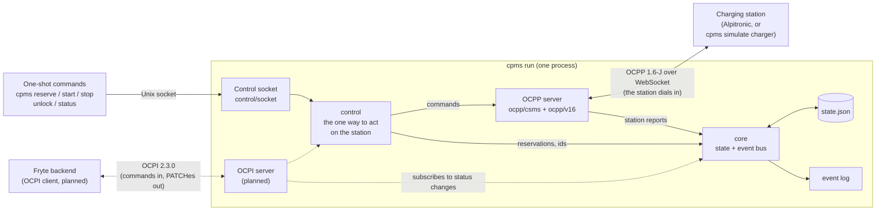
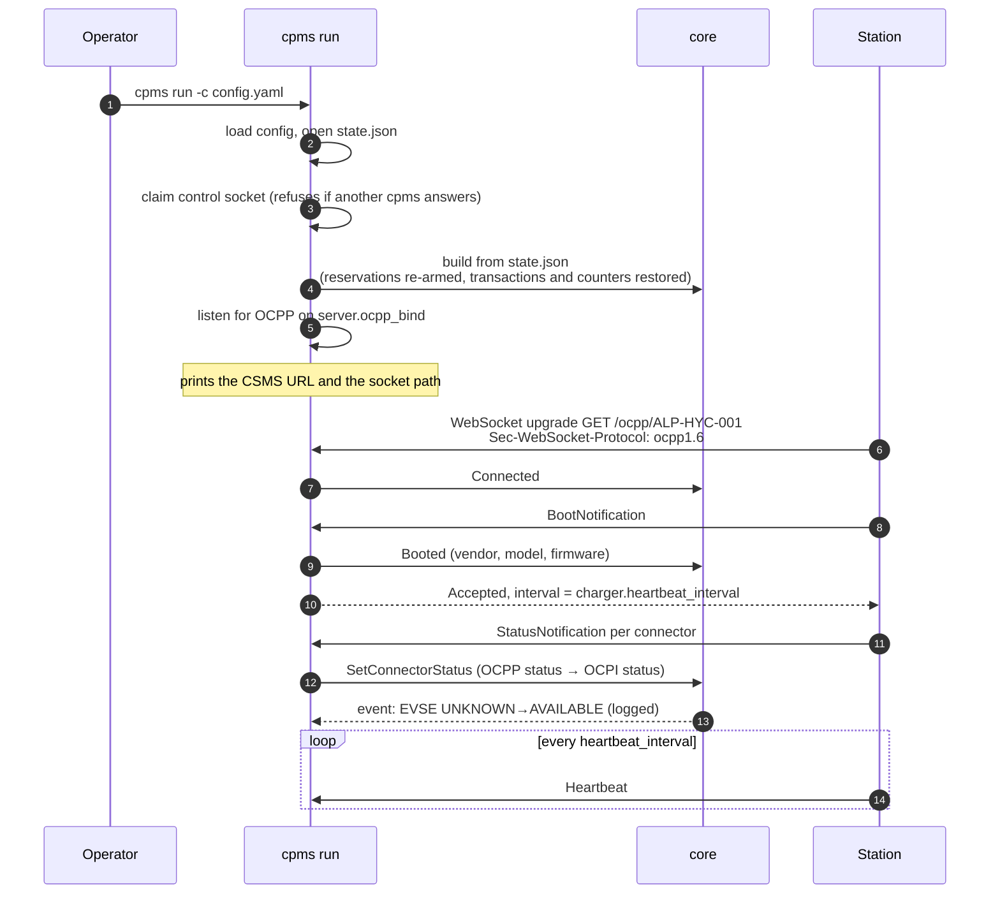
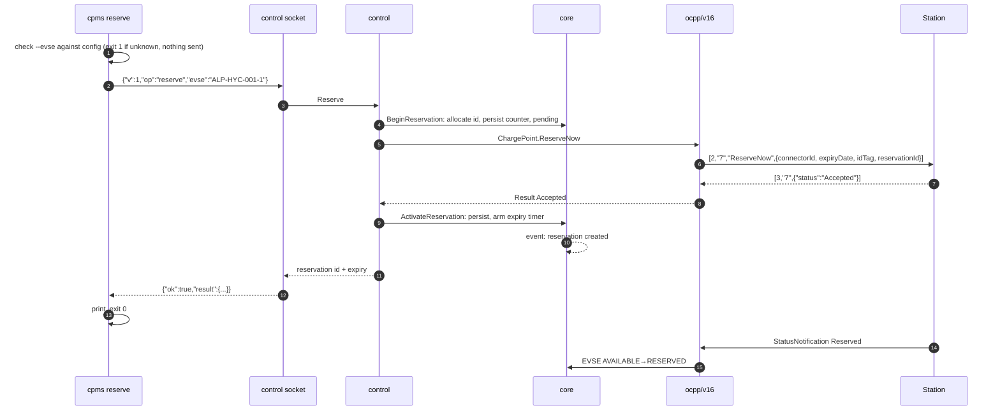
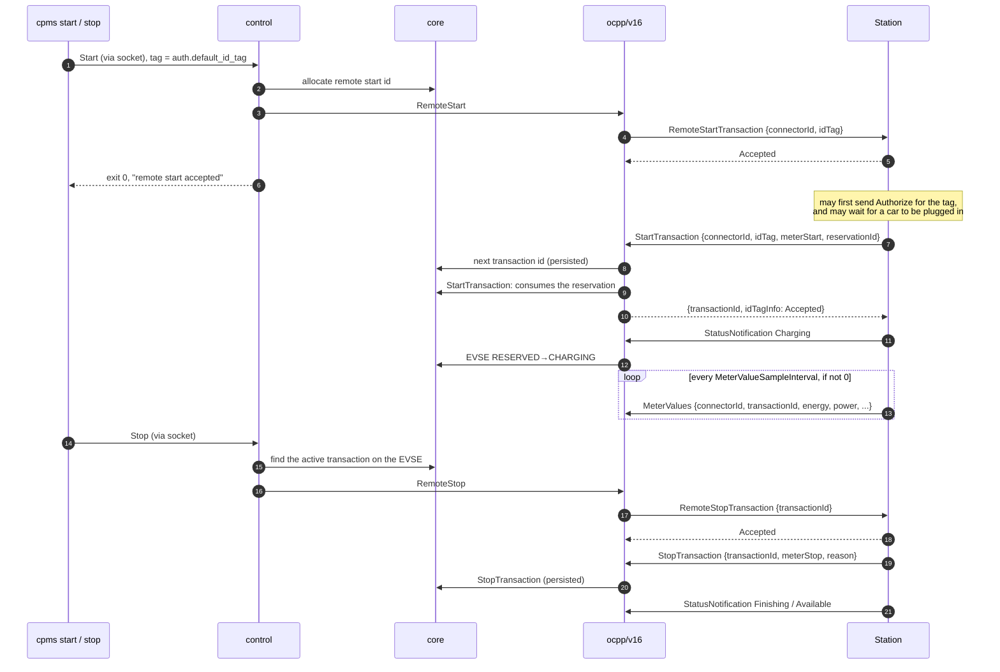
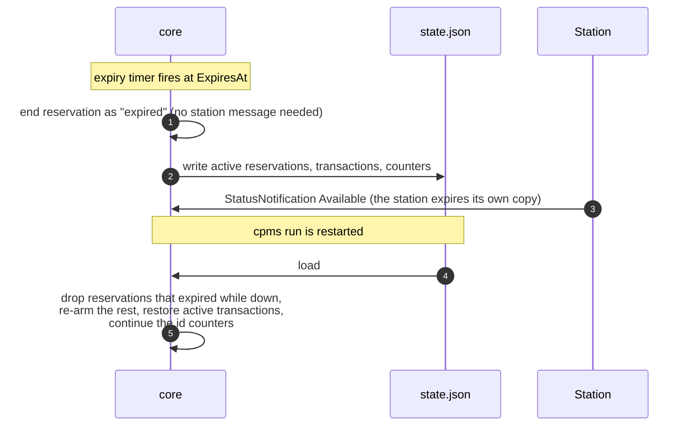
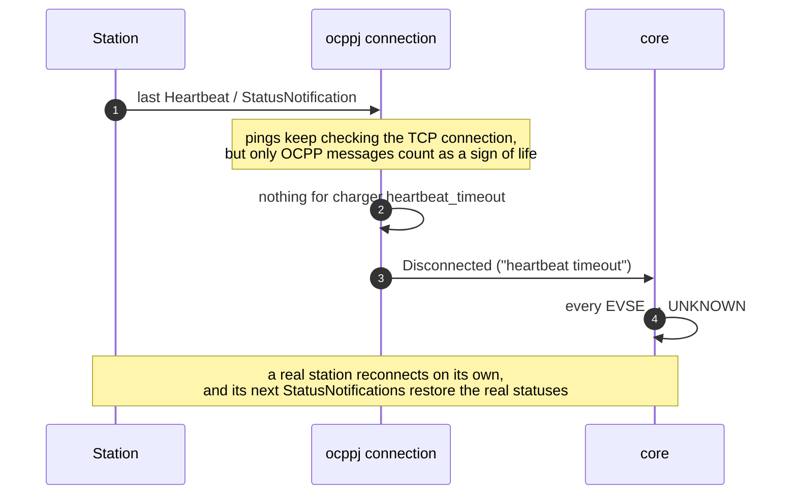
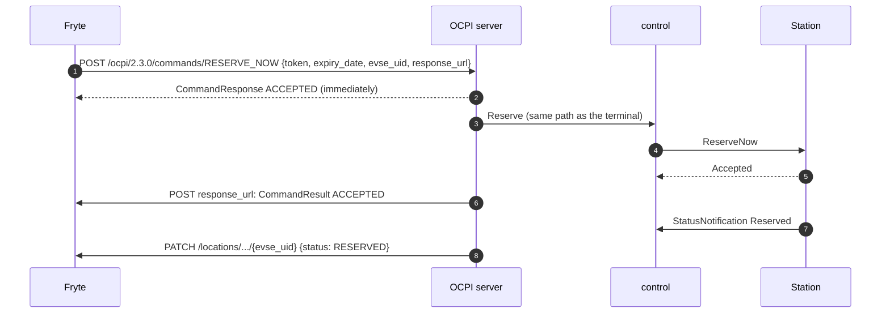

# headless-csms

A terminal charge point management system for a single OCPP charging station.

`cpms` is one static binary that:

- speaks **OCPP 1.6-J** (2.0.1 later) to the station, so you can reserve a connector,
  redeem the reservation with a known RFID tag, stop the session, and unlock the cable;
- exposes a minimal **OCPI 2.3.0 CPO** interface on the LAN — `versions`, `credentials`,
  `locations` (sender) and `commands` (receiver) — so a backend can register, pull static
  location data, and send `RESERVE_NOW` that ends up at the real charger;
- **PATCHes** EVSE status to the registered counterparty whenever it changes, whether the
  change came from the terminal or from someone physically plugging in a car;
- needs no database, no container and no web UI — one hand-edited config file, one binary.

## How the charger connects

This trips people up, so it is worth stating plainly: **in OCPP-J the charger is the
WebSocket client.** It dials us; we do not dial it. Configure the station's CSMS URL as:

```
ws://<host running cpms>:9000/ocpp/<charge point id>
```

`charger.ip` in the config is only used for a reachability pre-check and for display.

## Quickstart

```sh
make build                                   # -> bin/cpms
cp config.example.yaml config.yaml           # then edit it
./bin/cpms config validate -c config.yaml
```

A valid config prints the facts you need to get the station and the counterparty
talking to you:

```
config.yaml is valid.

  Charge point        ALP-HYC-001  (OCPP 1.6)  at 192.168.1.42
  OCPP listener       0.0.0.0:9000
  Station CSMS URL    ws://<this-host>:9000/ocpp/ALP-HYC-001
  Heartbeat timeout   90s
  OCPI listener       0.0.0.0:8080
  OCPI advertised as  http://192.168.1.10:8080/ocpi
  OCPI party          DE*FYT
  Default RFID tag    04A1B2C3D4
  Location            OFFICE-01 "Fryte HQ", München (DEU) — 2 EVSEs, 2 connectors
  State file          state.json

  EVSE           EVSE ID        OCPP CONNECTOR  CONNECTORS
  ALP-HYC-001-1  DE*FYT*E001*1  1               IEC_62196_T2_COMBO/CABLE/DC 920V 500A
  ALP-HYC-001-2  DE*FYT*E001*2  2               IEC_62196_T2_COMBO/CABLE/DC 920V 500A
```

Then start the CSMS and point the station at the URL it prints:

```sh
./bin/cpms run -c config.yaml
```

```
cpms listening for ALP-HYC-001 on ws://127.0.0.1:9000/ocpp/ALP-HYC-001
waiting for the charge point to connect; press Ctrl-C to stop
INFO msg="charge point connected" charge_point=ALP-HYC-001 version=1.6
INFO msg="ALP-HYC-001 booted (Alpitronic HYC300)"
INFO msg="ALP-HYC-001-1 UNKNOWN→CHARGING"
```

`--log-level debug` shows the protocol chatter underneath.

## Testing without the station

A charge point simulator is built into the binary, so the whole thing runs on a laptop.
In a second terminal:

```sh
./bin/cpms simulate charger -c config.yaml
```

With no flags it reads the same config file and points itself at the CSMS `cpms run` is
serving, so the two commands are a working pair out of the box. The station appears in the
first terminal:

```
INFO msg="charge point connected" charge_point=ALP-HYC-001 version=1.6
INFO msg="ALP-HYC-001 booted (Alpitronic HYC300 fw simulator)"
INFO msg="ALP-HYC-001-1 UNKNOWN→AVAILABLE"
INFO msg="ALP-HYC-001-2 UNKNOWN→AVAILABLE"
```

Scenarios make it misbehave on purpose, which is how the unhappy paths get tested:

| `--scenario` | Behaviour |
|---|---|
| `normal` | A cooperative station (default) |
| `reject-reserve` | Refuses every `ReserveNow`, and stops advertising the Reservation feature profile — what a station that cannot reserve actually looks like |
| `occupied` | Answers `ReserveNow` with `Occupied` |
| `slow` | Stalls every answer past the call timeout |
| `unlock-fails` | Refuses to release the cable lock |
| `silent` | Boots, then stops sending anything while still answering pings — a station whose OCPP layer has hung but whose connection is fine. This is what `heartbeat_timeout` exists to catch, and the only way to exercise it by hand |
| `offline-tx` | Charges through an outage, end to end. Implies `--reconnect`, and `--meter-interval 1s` unless given. Starts a transaction on connector 1 and waits for the connection to drop (stop `cpms run`, or have a proxy close it). Offline, it lets 3 meter values queue up, stops the transaction, and starts and stops a second one; only then does it redial, and after the boot it delivers the queue |

`--meter-interval 10s` makes a running session send `MeterValues` that often, combined with
any scenario (except `silent`, which still sends nothing). Each sample carries the
transaction id the CSMS assigned and four readings from a car drawing a constant 50 kW:
`Energy.Active.Import.Register` (Wh, rising with power × time), `Power.Active.Import` (W),
`Current.Import` (A) and `SoC` (%, from 20). The car is a 75 kWh battery starting at 20%,
so the register rises strictly for about 72 minutes. Once the battery is full, power and
current drop to 0, the SoC stays at 100 and the register stops rising; the connector then
sends one `StatusNotification` `SuspendedEV`, as a real full car does, and the session runs on
until it is stopped. `StopTransaction`'s `meterStop` is the last streamed register. The default, `0`, streams nothing, and a session
then moves the meter by a flat 1000 Wh as before. The simulator also answers
`ChangeConfiguration`, so a CSMS can move `MeterValueSampleInterval` (and
`HeartbeatInterval`) at run time and read it back with `GetConfiguration`.

By default the simulator exits when its connection drops. `--reconnect` makes it behave
like a station instead: it redials with backoff (1 s, 2 s, 4 s … capped at 30 s, each wait
shortened by up to a fifth at random), then sends `BootNotification` again and reports the
station and every connector again. A `BootNotification` the CSMS rejects after a reconnect
still makes it exit non-zero. The first dial is not retried: a CSMS that cannot be reached
at start-up is more likely a wrong `--csms` than an outage.

While it is offline it keeps charging, as a real station does. Sessions start and stop
locally, the meter keeps streaming, and every transaction message (`StartTransaction`,
`MeterValues`, `StopTransaction`) is queued with the timestamp it was made with. A session
started offline runs under a placeholder id of the simulator's own, which never goes on the
wire and which `TransactionID` does not report: that is 0 until the CSMS has answered the
`StartTransaction`. Once it has, the queued `MeterValues` and `StopTransaction` carry the
CSMS's id instead. Status changes are not queued: the status round after the boot reports where each
connector ended up. After an Accepted boot the queue goes out first, in order, one call at
a time, and a transaction message made while it does joins its end (OCPP 1.6 §3.7). The
status round follows; a meter sample made in the meantime can go out between its
`StatusNotification`s, which §3.7 allows. A message leaves the queue only once the CSMS has
answered it:

| Answer | What happens |
|---|---|
| `CALLRESULT` | Delivered |
| Any `CALLERROR`, or no answer within the call timeout | The CSMS failed to process it, which is what OCPP 1.6 §3.7.1 lets a station skip a message for only if it happens repeatedly: sent again after the backoff, at most 3 times in all (the stand-in for `TransactionMessageAttempts`), then given up. `FormationViolation` and the other codes that blame the message are retried like `InternalError`; the specification makes no exception for them |
| The connection drops | Stays queued, with everything behind it, for the next connection |

A `StartTransaction` that is given up takes the queued messages of its session with it, and
a session started offline that is still running ends locally: the meter stops and the
connector is Available again, which the status round reports. The simulator never sends a
message under the placeholder id, even though the CSMS may have opened the transaction and
only its answers been lost.

The queue lives in memory: a simulator that is restarted starts with an empty one. Offline
starts are always allowed; `LocalAuthorizeOffline` and `AllowOfflineTxForUnknownId` are not
consulted yet.

`--connectors`, `--id`, `--csms`, `--tag`, `--vendor` and `--model` override the config
when you want to point it somewhere else or fake a different station.

An invalid config exits 1 and names every problem by its field path, all in one pass:

```
config.yaml is not valid:

  auth.default_id_tag: "04A1 B2C3" is not a valid OCPP idTag; want 1-20 printable ASCII characters without spaces
  charger.id: is required
  location.evses[1].ocpp_connector_id: 1 is already mapped by location.evses[0]

3 problems found.
```

## Driving the station

While `cpms run` is serving, one-shot commands in another terminal act on the station
through it. With the simulator from the previous section in a second terminal, a third one
gives you the whole flow this tool exists for: reserve, redeem with the office tag, stop.

```
$ cpms reserve --evse ALP-HYC-001-1
ALP-HYC-001-1 reserved for 04A1B2C3D4 until 14:43:30 (reservation 1)

$ cpms status
ALP-HYC-001  online  Alpitronic HYC300 fw simulator  last seen 14:28:30

EVSE           STATUS     RESERVATION                   TRANSACTION
ALP-HYC-001-1  RESERVED   #1 04A1B2C3D4 until 14:43:30  -
ALP-HYC-001-2  AVAILABLE  -                             -

$ cpms start --evse ALP-HYC-001-1
ALP-HYC-001-1 remote start accepted

$ cpms status
...
ALP-HYC-001-1  CHARGING   -            1 04A1B2C3D4 since 14:28:32

$ cpms stop --evse ALP-HYC-001-1
ALP-HYC-001-1 remote stop accepted
```

| Command | Does |
|---|---|
| `cpms reserve [--evse UID] [--tag TAG] [--expires 15m]` | Holds an EVSE for a tag. The tag defaults to `auth.default_id_tag`, the length to 15 minutes. |
| `cpms cancel [--evse UID]` | Releases the reservation on an EVSE |
| `cpms start [--evse UID] [--tag TAG]` | Asks the station to start a session. It returns once the station accepts; the session shows up in `status` when the station reports it. |
| `cpms stop [--evse UID]` | Stops the session running on an EVSE |
| `cpms unlock [--evse UID]` | Releases the cable lock |
| `cpms status [--json]` | The station, and per EVSE its status, reservation and session. `--json` is a stable format for scripts. |
| `cpms probe [--json] [--raw]` | What the station supports and how it is set up; see [Probing the station](#probing-the-station). |

`--evse` takes the EVSE `uid` from config, and may be left out when only one EVSE is
configured. A typo is caught from config before anything is sent, and the error lists the
valid uids.

**Exit codes** are stable, so scripts can branch on them:

| Code | Meaning |
|---|---|
| 0 | Success |
| 1 | Usage, config, or unexpected error (including an unknown `--evse`) |
| 2 | `cpms run` is not reachable |
| 3 | The charge point is not connected to cpms |
| 4 | The station rejected the command |
| 5 | The station is occupied |
| 6 | The station is faulted or unavailable |
| 7 | The station did not answer within `charger.call_timeout` |
| 8 | Unlock failed, or the station does not support the command |
| 9 | Refused by cpms before sending: already reserved (including while the cancel of a timed-out reservation is in flight), no reservation to cancel, nothing to stop, shutting down |
| 10 | `cpms probe`: the station reported that it lacks a capability cpms requires (one it merely did not report is not an error) |

**How it works.** `cpms run` listens on a Unix socket, `cpms.sock` next to the state file by
default (`--socket` overrides it; use the same value for `run` and the commands). The socket
is `0600` and removed on shutdown. It also stops a second `cpms run` on the same state: the
second one finds the first answering and exits with "another cpms is already running". A
socket left behind by a `cpms run` that was killed is detected and replaced.

Socket paths are limited to 103 bytes, a kernel limit on macOS. If the default path next to
the state file is longer than that, cpms falls back to a short path in the temp directory
(`cpms-<hash of the state path>.sock`), which `run` and the commands both derive on their
own; `cpms run` prints the path it uses. A `--socket` you give explicitly is used as is.

## Probing the station

The reservation path assumes the station implements OCPP reservations, and not every unit
does. `cpms probe` is the first thing to run against a new station: it asks for the station's
whole configuration and reports what cpms can rely on. It is read-only and changes nothing
on the station.

```
$ cpms probe
ALP-HYC-001  OCPP 1.6
  Alpitronic HYC300, firmware simulator

Features
  Core                ✓  required  start, stop, unlock
  Reservation         ✓  required  reserve, cancel, OCPI RESERVE_NOW
  RemoteTrigger       ✓  optional  status refresh on demand
  FirmwareManagement  ✓            not used by cpms

Settings
  ReserveConnectorZeroSupported  false  whether the whole station can be reserved at once; cpms always reserves one EVSE, so this is informational
  AuthorizeRemoteTxRequests      false  if true, the station asks cpms to Authorize the tag of a remote start; cpms accepts only auth.default_id_tag
  LocalAuthListEnabled           false  if true, a whitelist held on the station can let tags charge without asking cpms
  LocalPreAuthorize              false  if true, the station starts at once for tags it knows locally, before cpms answers
  LocalAuthorizeOffline          false  if true, the station lets tags it knows locally charge while cpms is unreachable
  NumberOfConnectors             2      how many connectors the station has; checked against the EVSEs in config
  HeartbeatInterval              60     seconds between heartbeats; cpms sets it at boot from charger.heartbeat_interval
  ConnectionTimeOut              60     seconds the station waits for a cable after a remote start or a presented tag
  MeterValueSampleInterval       0      seconds between meter values during a session; 0 means none are sent

Checks
  ok  2 connectors, matching the 2 EVSEs in config
  ok  heartbeat every 60s, as charger.heartbeat_interval says

Every capability cpms requires is present.
```

A station without the Reservation profile, here `cpms simulate charger --scenario
reject-reserve`, exits **10**:

```
Features
  Core                ✓  required  start, stop, unlock
  Reservation         ✗  required  reserve, cancel, OCPI RESERVE_NOW
  ...

Reservation is missing: OCPI RESERVE_NOW cannot be passed on to the station, so cpms would have to hold reservations itself.
cpms: the station lacks 1 capability that cpms requires: reservation
```

- **Features** are named as the station names them (1.6 feature profiles). Core and
  Reservation are required; without RemoteTrigger cpms only learns about status changes when
  the station reports them by itself.
- **Missing is not the same as not reported.** A capability the station reports as absent
  is *missing*, and makes the command exit 10. A required capability the station says
  nothing about (`?`) is *unconfirmed*: a warning that suggests trying it, such as
  `cpms reserve`, with exit 0. Some stations list no `SupportedFeatureProfiles` at all;
  Core is mandatory in OCPP 1.6, so it is then assumed present, and the probe says so.
- **Settings** are the keys that change how the station behaves towards cpms. A key the
  station does not report shows as `not reported`; that is not an error.
- **Checks** compare the station with config. A connector count that differs from the EVSEs
  in config, or a heartbeat interval other than `charger.heartbeat_interval`, is a warning
  (`!`); it does not change the exit code.
- `--raw` adds every key the station reported, with whether it is read-only. `--json` prints
  the whole report, including every key, with `ok`, `missing`, `unconfirmed` and `warnings`
  for scripts. `ok` is false only when `missing` is not empty.

If the station is not connected, `cpms probe` exits 3 and prints the CSMS URL to configure on
the station, the same one `cpms config validate` prints, plus when and why it last
disconnected.

## Configuration

Everything lives in one YAML file — see [`config.example.yaml`](config.example.yaml),
which is commented field by field and is itself checked by the test suite.

Two files, one rule: **`config.yaml` is read-only to the tool.** It holds what you decide
(the charger, the static location data, and the two OCPI tokens that are ours to choose).
`state.json` holds what the tool learns at runtime (the counterparty's token and endpoints,
active reservations and transactions, and the id counters) and is the only file cpms writes.

`state.json` sits next to the config file by default, wherever cpms is started from;
`--state <path>` puts it elsewhere, and `cpms config validate` prints which file is in use.
It is created on the first write, not at startup, so a tool that has never been registered
leaves no trace. Writes are atomic (temp file, fsync, rename) and the file is `0600`, because it
holds the counterparty's bearer token. It is indented JSON, so `cat` works. A file cpms cannot
parse, or one written by a newer cpms, stops `cpms run` at startup with the file named, and is
never overwritten: move it aside to start from empty state.

What survives a restart: **active** reservations (with their expiry timers re-armed; one that
expired while cpms was down is dropped), **active** transactions (so the station can still stop
a session that began before the restart), and the counters behind reservation, transaction and
remote-start ids, which are never handed out twice. Reservations still waiting for the
station's answer (or for the answer to their cancel), and finished sessions, are deliberately not kept: `state.json` is not a
history.

Any change to its schema bumps the `version` field. A cpms only reads its own version, so an
older build refuses a newer file instead of silently dropping fields it does not know.

That split is why `ocpi.token_c` is a fixed value in config rather than being generated
during the OCPI handshake as implementations usually do.

Two listener rules worth knowing, both enforced at validation time:
`heartbeat_timeout` must exceed `heartbeat_interval` (otherwise a punctual station gets
marked offline between two beats), and neither listener may use port 0 (a charger cannot
be pointed at a randomly chosen port).

## Architecture

### The big picture



Three things talk to `cpms run`, and each one has exactly one way in:

- **The station dials us.** In OCPP-J the charge point is the WebSocket client, so `cpms run`
  is a server and the station's CSMS URL points at it. Nothing in cpms ever dials the station.
- **One-shot commands go through the control socket.** They cannot talk to the station
  themselves, because the station's only connection is to `cpms run`. They send one request
  to the socket and get one answer back, then exit.
- **Fryte will come in over OCPI** (roadmap steps 5–8). It ends up in the same `control`
  layer as the terminal, so a reservation from Fryte and one from the terminal are the same
  thing to the rest of cpms.

### Inside `cpms run`

A few rules hold the design together:

- **`core` is the single source of truth.** It holds every connected station, every EVSE's
  status, reservations and transactions, and publishes an event for every change. The event
  log, and later the TUI and the OCPI push, are subscribers. Nothing else keeps charger state.
- **`control` is the single way to act on the station.** It validates the EVSE, allocates and
  persists ids, sends the command, interprets the answer, and records the outcome in `core`.
  The socket, and later OCPI and the TUI, are thin transports in front of it.
- **Protocol versions stay in their adapters.** `ocpp/csms` routes raw messages by the
  negotiated subprotocol and never learns a message name. `ocpp/v16` translates between 1.6
  messages and the version-agnostic `core` and `ocpp.ChargePoint`. OCPP 2.0.1 will be a
  sibling adapter, not a rewrite.
- **`config.yaml` is read, `state.json` is written.** Active reservations, active
  transactions and the id counters survive a restart; nothing else is persisted.

### Packages

```
internal/core            domain state and the event bus — the single source of truth
internal/control         the one place that acts on the station: reserve, cancel, start, stop, unlock, probe
internal/control/socket  the Unix socket the one-shot commands reach `cpms run` through
internal/ocpp            version-agnostic RPC errors, versions, the Handler and ChargePoint interfaces, ProbeReport
internal/ocpp/ocppj      the OCPP-J RPC layer: framing, correlation, connection goroutines
internal/ocpp/csms       the WebSocket server a charge point dials into
internal/ocpp/v16        OCPP 1.6-J payloads, the adapter that writes to core, and the command adapter
internal/state           state.json: the persisted DTOs and the atomic-write store
internal/simulator       a charge point: dials a CSMS and behaves like a station
internal/cli             the command tree: run, simulate, the one-shot commands, config validate
internal/ocpptest        a raw OCPP-J client used by the tests
internal/statetest       a state store whose writes can be made to fail, for tests
internal/clocktest       a manually advanced clock, for tests that wait on expiry
```

### The important sequences

#### Startup, and the station connecting



The identity is the **last** segment of the URL path, so `/ocpp/<id>`, `/<id>` and longer
vendor prefixes all work. An identity other than `charger.id` is rejected with HTTP 404.

#### Reserving from the terminal



If the station answers anything but `Accepted`, or does not answer within
`charger.call_timeout`, the pending reservation is ended at once and the CLI exits with the
matching code (4–7). After a timeout or a failure the station may still have received the
request, so `cpms run` sends a `CancelReservation` in the background and the reservation shows
as `state: cancelling` in `cpms status` until that has an answer; the EVSE refuses a new
reservation (exit 9) meanwhile. It is not persisted, like a pending one. `core` only shows `RESERVED` when the station reports it; the
reservation record sits next to the status rather than overwriting it.

#### Redeeming the reservation: start and stop



A session that starts **without** `reservationId` on the same connector with the same tag
also consumes the reservation, because some stations leave the field out. A different tag
leaves the reservation in place.

#### Expiry, and restarting cpms



Ids are never handed out twice, even after a restart: the counters are persisted with every
allocation, and on load they are also kept ahead of every id still in the file.

#### The station goes silent



#### Planned: Fryte reserves over OCPI

Roadmap steps 5–8. The OCPI side ends in the same `control.Reserve` as the terminal.



### Design notes

`csms` never learns a message name: it routes `(charge point, action, raw payload)` to the
`ocpp.Handler` chosen by the negotiated WebSocket subprotocol. That is what lets OCPP 2.0.1
arrive later as a sibling of `v16` rather than as a rewrite.

Commands go the other way through `ocpp.ChargePoint`, which `csms.Server.Command(id)` hands
out: `ReserveNow`, `CancelReservation`, `RemoteStart`, `RemoteStop`, `UnlockConnector`,
`TriggerStatus` and `Capabilities`. Callers address EVSEs by their OCPI `uid` from config and
get back a version-agnostic status (`Accepted`, `Occupied`, `UnlockFailed`, ...) alongside the
station's literal answer. A station saying no is a result, not an error; errors are for the
call itself failing (`ocpp.ErrTimeout`, `ocpp.ErrNotConnected`, `ocpp.ErrUnknownEVSE`, or the
station's CALLERROR as `*ocpp.RPCError`). The exact 1.6 payloads are pinned by golden files in
`internal/ocpp/v16/testdata/golden`; regenerate them deliberately with
`go test ./internal/ocpp/v16 -run Golden -update`.

Nothing calls `ChargePoint` directly except `internal/control`. It is the single path for
"do something to the station": it validates the EVSE, allocates and persists the id, sends
the command, interprets the answer and records the outcome in core, and it returns typed
errors (`*control.RefusedError` for a station's no, `control.ErrAlreadyReserved`,
`control.ErrNoReservation`, `control.ErrNoActiveTransaction`, plus the `ocpp` sentinels above)
so the CLI can turn them into exit codes and OCPI into command results. A reservation becomes
active only once the station accepts it; on a refusal or a timeout it is dropped at once, so
nothing lingers that the station may not hold. Core still reports an EVSE as `RESERVED` only
when the station does: the reservation record sits next to the status, it does not overwrite it.

`ocppj` is direction-agnostic on purpose. A CSMS connection and a charge point connection
differ only in who performs the handshake, so both ends share one implementation of the
framing and correlation rather than keeping two that can drift apart.

The charge point identity is taken from the **last** path segment of the WebSocket URL, so
`/ocpp/<id>`, `/<id>` and `/steve/websocket/CentralSystemService/<id>` all work — vendors
disagree, and a charger that dials in and is silently rejected is miserable to debug on site.

## Development

```sh
make ci      # gofmt check, go vet, golangci-lint, go test -race
make test
make lint    # needs: go install github.com/golangci/golangci-lint/v2/cmd/golangci-lint@v2.6.2
```

## Status

Built in tracked steps; each lands as its own PR.

| # | Scope | State |
|---|---|---|
| 1 | Project skeleton, config loader, CI | done |
| 2 | OCPP 1.6-J CSMS: WebSocket server and message routing | done |
| 3 | Built-in charge point simulator | done |
| 4 | Outbound OCPP commands, reservation lifecycle, one-shot CLI | in progress: commands and `cpms probe` done, on-site hardware check next |
| 5 | OCPI foundation: versions + credentials handshake | |
| 6 | OCPI Locations module (sender) | |
| 7 | PATCH location on status change | |
| 8 | OCPI Commands module (receiver) | |
| 9 | Terminal UI | |
| 10 | OCPP 2.0.1 | |
| 11 | Docs and release builds | |

Out of scope for now: the OCPI Booking module, CDRs, sessions, tariffs, payment terminals,
multiple OCPI versions, and any web UI.

Ideas that are worth keeping but not planned, among them CDRs, an API-only mode and a fuller
terminal UI, live in the [idea fridge](docs/IDEAS.md).

## License

[MIT](LICENSE).

This is a personal hobby project. It is used as an internal test environment at Fryte,
but it is not an official Fryte product and Fryte does not maintain or support it.
