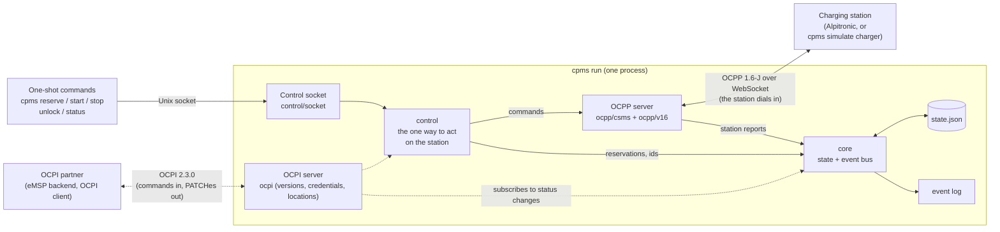

# Architecture

One Go process, `cpms run`, holds everything. The message-level view is in
[Sequences](sequences.md).

## The big picture

Dotted lines are planned: OCPI commands in and status `PATCH`es out.

## Four rules

| Rule | Meaning |
|---|---|
| **`core` is the single source of truth.** | It holds the station, every EVSE's status, reservations and sessions, and publishes an event for every change. The event log (and later the TUI and the OCPI push) subscribe. Nothing else keeps charger state. |
| **`control` is the single way to act on the station.** | It validates the EVSE, allocates and persists ids, sends the command, interprets the answer and records the outcome in `core`. The socket (and later OCPI and the TUI) are thin transports in front of it. |
| **Protocol versions stay in their adapters.** | `ocpp/csms` routes raw messages by the negotiated subprotocol and never learns a message name. `ocpp/v16` translates between 1.6 messages and the version-agnostic `core`. OCPP 2.0.1 will be a sibling adapter, not a rewrite. |
| **`config.yaml` is read, `state.json` is written.** | See [Configuration](../reference/configuration.md#statejson). |

## Packages

All under [`internal/`](https://github.com/wolffseb/headless-csms/tree/main/internal).

| Package | Role |
|---|---|
| `core` | Domain state and the event bus |
| `control` | The one place that acts on the station: reserve, cancel, start, stop, unlock, probe |
| `control/socket` | The Unix socket the one-shot commands reach `cpms run` through |
| `ocpp` | Version-agnostic RPC errors, the `Handler` and `ChargePoint` interfaces, `ProbeReport` |
| `ocpp/ocppj` | The OCPP-J RPC layer: framing, correlation, connection goroutines |
| `ocpp/csms` | The WebSocket server a charge point dials into |
| `ocpp/v16` | OCPP 1.6-J payloads, the adapter that writes to `core`, and the command adapter |
| `ocpi` | The OCPI transport: HTTP server, envelope, token auth, module registry, versions |
| `ocpi/client` | Calls to the partner's OCPI API |
| `ocpi/credentials` | The credentials module and registration handshake |
| `ocpi/locations` | The Locations module (sender): config plus live status, paginated |
| `config` | Loads and validates `config.yaml` |
| `state` | `state.json`: the persisted DTOs and the atomic-write store |
| `simulator` | A charge point: dials a CSMS and behaves like a station |
| `cli` | The command tree |
| `ocpptest`, `statetest`, `clocktest` | Test helpers: a raw OCPP-J client, a store whose writes can fail, a manual clock |

## Design notes

### Inbound: `csms` never learns a message name

It routes `(charge point, action, raw payload)` to the `ocpp.Handler` chosen by the
negotiated WebSocket subprotocol. That is what lets OCPP 2.0.1 arrive as a sibling of `v16`.

### Outbound: one interface, one caller

Commands go through `ocpp.ChargePoint`, which `csms.Server.Command(id)` hands out:

| Group | Methods |
|---|---|
| Sessions | `ReserveNow`, `CancelReservation`, `RemoteStart`, `RemoteStop`, `UnlockConnector` |
| Station | `TriggerStatus`, `Capabilities`, `Probe` |
| Smart charging | `SetChargingProfile`, `ClearChargingProfile`, `GetCompositeSchedule` |

Callers address EVSEs by their OCPI `uid` and get back a version-agnostic status
(`Accepted`, `Occupied`, `UnlockFailed`, ...) alongside the station's literal answer.

Nothing calls `ChargePoint` directly except `internal/control`.

### A station saying no is a result, not an error

| Kind | Examples | Becomes |
|---|---|---|
| The station's answer | `Rejected`, `Occupied` | `*control.RefusedError` |
| cpms refusing | `control.ErrAlreadyReserved`, `ErrNoReservation`, `ErrNoActiveTransaction` | Exit 9 |
| The call failing | `ocpp.ErrTimeout`, `ocpp.ErrNotConnected`, `ocpp.ErrUnknownEVSE`, `*ocpp.RPCError` | Exit 7, 3, 1, ... |

Typed errors let the CLI turn them into [exit codes](../reference/cli.md#exit-codes), and
later OCPI into command results.

### Reservations

A reservation becomes active only once the station accepts it. On a refusal or a timeout
it is dropped at once, so nothing lingers that the station may not hold. `core` reports an
EVSE as `RESERVED` only when the station does.

### Charging profiles are validated before sending

Periods from 0 and strictly increasing, limits with at most one decimal place, only a `Tx`
profile takes a transaction, only `StationMax` may address the whole station. A bad one
fails with `ocpp.ErrInvalidProfile`.

### `ocppj` is direction-agnostic

A CSMS connection and a charge point connection differ only in who performs the handshake.
Both ends (server and simulator) share one implementation of framing and correlation.

### The identity is the last path segment

`/ocpp/<id>`, `/<id>` and `/steve/websocket/CentralSystemService/<id>` all work. Vendors
disagree, and a charger that is silently rejected is miserable to debug on site.
