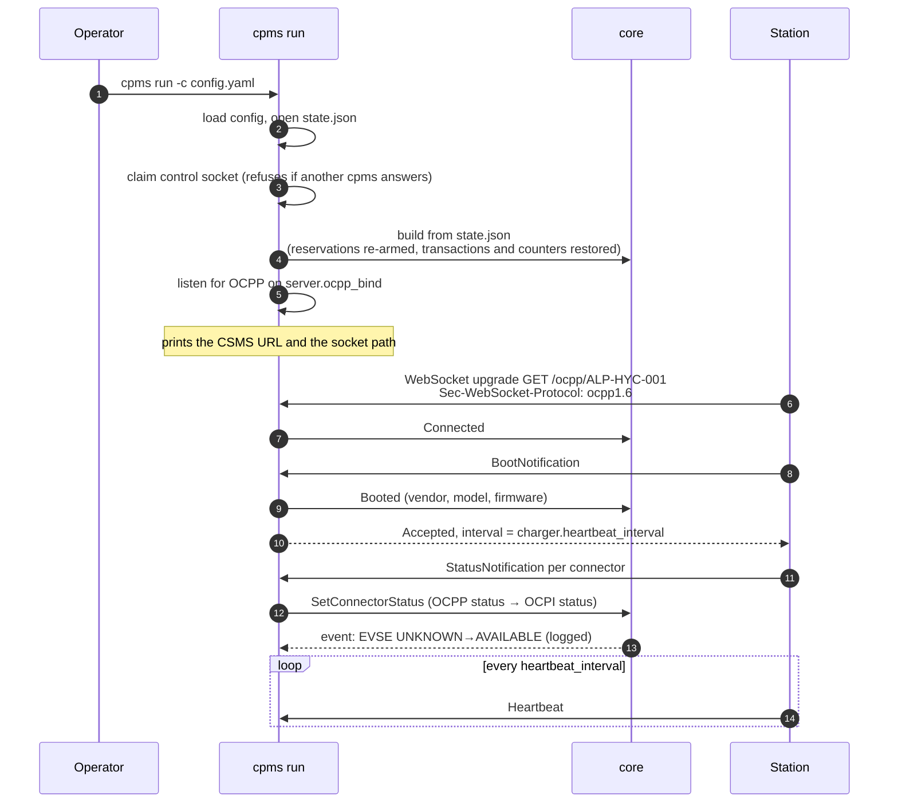
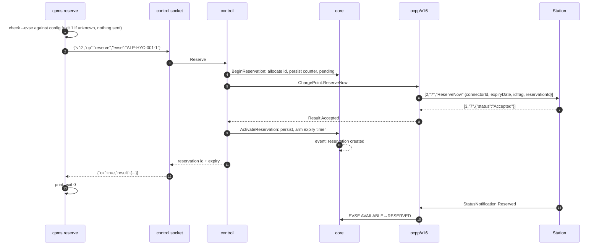
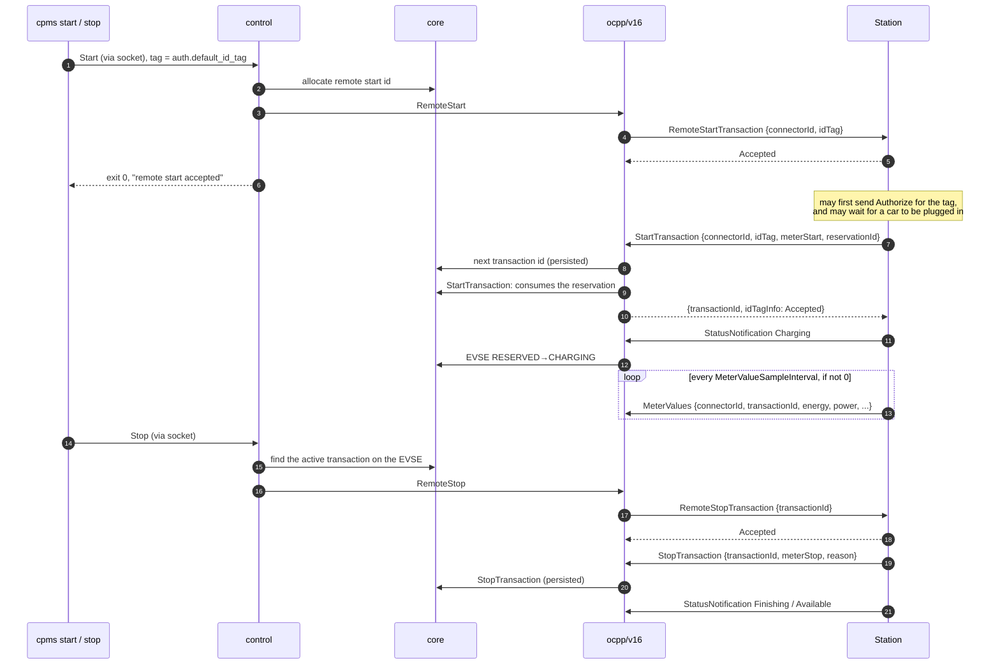
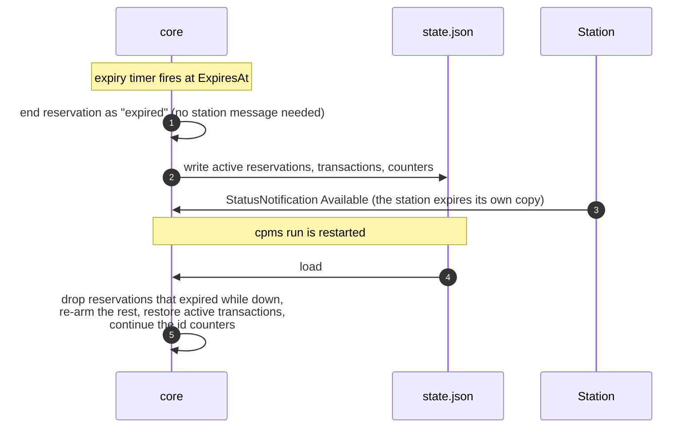
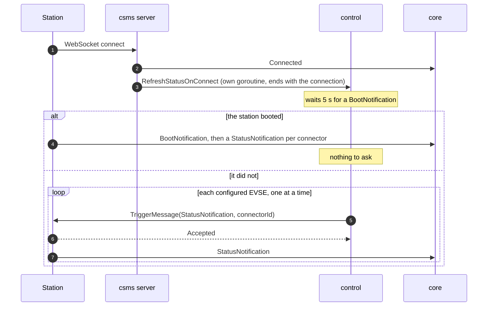
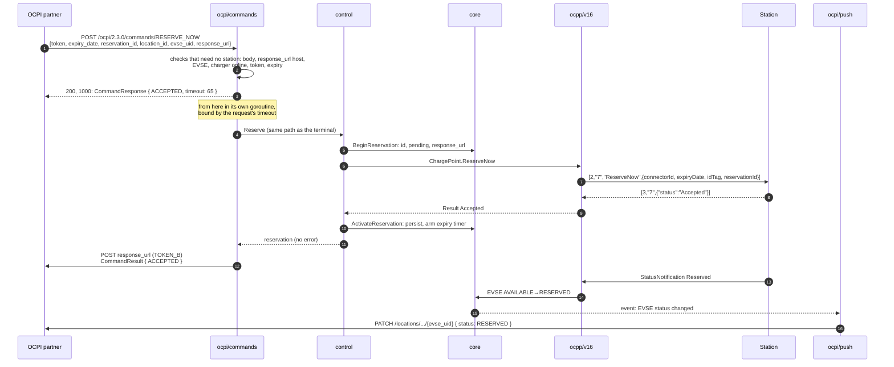
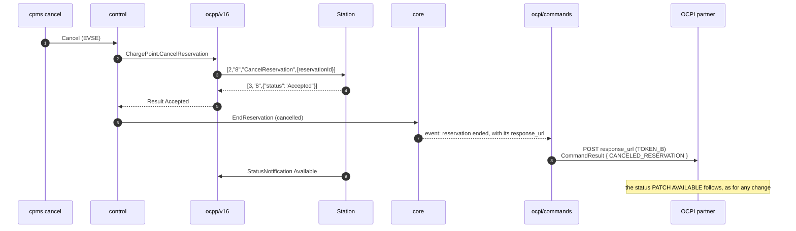

# Sequences

The important flows, message by message. Message names are OCPP 1.6
([specification](https://openchargealliance.org/protocols/open-charge-point-protocol/)).

| Flow | Starts with |
|---|---|
| [Startup](#startup-and-the-station-connecting) | `cpms run` |
| [Reserve](#reserving-from-the-terminal) | `cpms reserve` |
| [Start and stop](#redeeming-the-reservation-start-and-stop) | `cpms start`, `cpms stop` |
| [Expiry and restart](#expiry-and-restarting-cpms) | A timer, or a restart |
| [Silence](#the-station-goes-silent) | A missing heartbeat |
| [Reconnect](#the-station-reconnects) | The station dialling in again |
| [OCPI reserve](#an-ocpi-partner-reserves) | A partner's `RESERVE_NOW` |
| [The CPO cancels](#the-cpo-cancels) | `cpms cancel` of a reservation made over OCPI |

## Startup, and the station connecting



The identity is the **last** segment of the URL path, so `/ocpp/<id>`, `/<id>` and longer
vendor prefixes all work. An identity other than `charger.id` is rejected with HTTP 404.

## Reserving from the terminal



If the station answers anything but `Accepted`, or does not answer within
`charger.call_timeout`, the pending reservation is ended at once and the CLI exits with the
matching code (4–7). After a timeout or a failure the station may still have received the
request, so `cpms run` sends a `CancelReservation` in the background and the reservation shows
as `state: cancelling` in `cpms status` until the station has answered it; the EVSE refuses a
new reservation (exit 9) meanwhile. The cancel waits for its turn behind any command on the
wire, and a cancel that does not get its turn within `charger.call_timeout` is queued again,
not dropped. The record ends when the station answers, when the connection drops, when the
cancel itself goes unanswered for `charger.call_timeout`, or when `cpms run` shuts down. In the
last three cases the station may still hold the reservation until its expiry, and answers a new
reserve on that EVSE `Occupied` until then. A
reservation that was never sent (exit 12) has nothing to
cancel: it ends at once and no `CancelReservation` follows. It is not persisted, like a pending one. `core` only shows `RESERVED` when the station reports it; the
reservation record sits next to the status rather than overwriting it.

## Redeeming the reservation: start and stop



A session that starts **without** `reservationId` on the same connector with the same tag
also consumes the reservation, because some stations leave the field out. A different tag
leaves the reservation in place.

## Expiry, and restarting cpms



Ids are never handed out twice, even after a restart: the counters are persisted with every
allocation, and on load they are also kept ahead of every id still in the file.

## The station goes silent

```mermaid
sequenceDiagram
    autonumber
    participant St as Station
    participant Conn as ocppj connection
    participant Core as core

    St->>Conn: last Heartbeat / StatusNotification
    Note over Conn: pings keep checking the TCP connection,<br/>but only OCPP messages count as a sign of life
    Conn->>Conn: nothing for charger.heartbeat_timeout
    Conn->>Core: Disconnected ("heartbeat timeout")
    Core->>Core: every EVSE → UNKNOWN
    Note over St,Core: a real station reconnects on its own;<br/>see the next diagram for how the statuses come back
```

## The station reconnects

OCPP 1.6 asks for `StatusNotification`s only after a `BootNotification`. A station that
reconnects without rebooting (the Alpitronic HYC50 does) may send nothing but heartbeats,
and until a connector changes state every EVSE would read `UNKNOWN` after a restart of
cpms, or keep the status from before the outage, in `cpms status` and over OCPI. So every
new connection gets a `TriggerMessage(StatusNotification)` per configured EVSE, unless the
station boots within 5 seconds of connecting, in which case it reports by itself.



Each request is bounded by `charger.call_timeout` and nothing is retried. A station
without the RemoteTrigger profile (`Rejected`, `NotImplemented`, or a CALLERROR) gets one
INFO line in the log and stays connected; its EVSEs then wait for its next status change.

## An OCPI partner reserves

The OCPI side ends in the same `control.Reserve` as the terminal. The command is answered
before the station is asked, and the result is posted afterwards. See
[Take commands from the partner](../guides/ocpi-commands.md). The status `PATCH` at the end
is [the push](../guides/ocpi-push.md).



Anything the station refuses or leaves unanswered ends in the same place, with another
`result`: `Rejected` is `REJECTED`, `Occupied` is `EVSE_OCCUPIED`, no answer is `TIMEOUT`
([the table](../guides/ocpi-commands.md#the-result)). A `CommandResult` the partner does not
take is sent again after a backoff, in its own goroutine, so the next command is not held up.

### The CPO cancels

A reservation that was active and ends because the operator cancelled it is reported to the
partner without being asked, as `CANCELED_RESERVATION`. `ocpi/commands` finds out from the
event `core` publishes.



The event carries the `response_url` only for a reservation that was **active**, and only
the reasons `cancelled` and `failed` (another tag started a session on the EVSE) are
reported. Expiry and redemption tell the partner nothing, and neither does the partner's own
`CANCEL_RESERVATION`, which has its result. The post goes out only while the registration
the `response_url` arrived under is still the current one.
