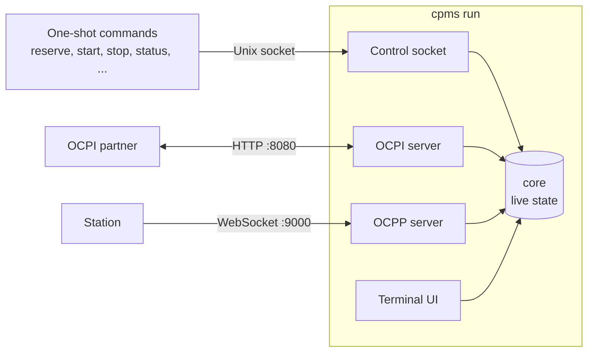

# Concepts

What you need to know before the rest of the docs make sense.

## The station dials us

In OCPP-J the **charging station is the WebSocket client**. `cpms run` is a server and
never dials the station. You configure the station with this CSMS URL:

```
ws://<host running cpms>:9000/ocpp/<charge point id>
```

`charger.ip` in the config is only used for a reachability pre-check and for display.

## Three ways in



| Who | Protocol | Notes |
|---|---|---|
| The station | OCPP 1.6-J over WebSocket | Its only connection is to `cpms run`. |
| You | The [terminal UI](guides/terminal-ui.md) of `cpms run`, or `cpms <command>` over a Unix socket | The UI is `cpms run` itself. Commands need a running `cpms run`: they send one request, print the answer and exit. |
| An OCPI partner | OCPI 2.3.0 over HTTP | Must [register](guides/ocpi-partner.md) first. cpms then [pushes status changes](guides/ocpi-push.md) to it. |

## Vocabulary

OCPP and OCPI name the same things differently. `cpms` uses the OCPI names.

| Term | Meaning | In OCPP 1.6 | In OCPI |
|---|---|---|---|
| **CSMS** | The backend a station connects to. Here: `cpms run`. | Central System | (part of the CPO) |
| **Charge point** | The station as a whole. | Charge Point, connector `0` | |
| **EVSE** | One outlet that charges one car at a time. | Connector `1..n` | EVSE (`uid`) |
| **Connector** | A plug or socket on an EVSE. | | Connector |
| **idTag** | The RFID tag that authorises a session. | `idTag` | Token |
| **CPO / eMSP** | The charger operator (us) and the driver's provider (the partner). | | Roles |

!!! note "One mapping to remember"
    OCPP 1.6 addresses an outlet by an integer connector id, OCPI by an EVSE `uid`.
    Each EVSE in the config maps the two with `ocpp_connector_id`. The CLI takes the `uid`.

## EVSE status

`cpms` reports status in OCPI terms, taken from what the station says.

| OCPP 1.6 status | Shown as | Why |
|---|---|---|
| `Available` | `AVAILABLE` | |
| `Preparing` | `AVAILABLE` | A driver plugs in first and starts from the app, so the EVSE must stay bookable. |
| `Charging`, `SuspendedEV`, `SuspendedEVSE` | `CHARGING` | A pause inside a session is not its end. |
| `Finishing` | `BLOCKED` | The session is over but the car is still in the bay. |
| `Reserved` | `RESERVED` | Only when the station says so, never from our own records. |
| `Unavailable` | `INOPERATIVE` | |
| `Faulted` | `OUTOFORDER` | |
| (station offline) | `UNKNOWN` | |

A fault or unavailability reported for connector `0` overrides every EVSE.

## Two files

| File | Who writes it | Holds |
|---|---|---|
| `config.yaml` | You. **cpms never writes it.** | The charger, the static location data, and our two OCPI tokens. See [Configuration](reference/configuration.md). |
| `state.json` | cpms only | What it learns at runtime: the partner's token and endpoints, active reservations and sessions, accepted charging profiles, id counters. |

## Specifications

| Protocol | Where to read it |
|---|---|
| OCPP 1.6-J | [Open Charge Alliance](https://openchargealliance.org/protocols/open-charge-point-protocol/) (free download, including the errata) |
| OCPI 2.3.0 | [github.com/ocpi/ocpi](https://github.com/ocpi/ocpi/tree/release-2.3.0-bugfixes), maintained by the [EVRoaming Foundation](https://evroaming.org/ocpi/) |
| OCPI terms | [Terminology and definitions](https://github.com/ocpi/ocpi/blob/release-2.3.0-bugfixes/terminology.asciidoc) |
