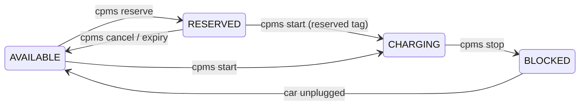

# Run a charging session

Reserve an EVSE, redeem the reservation with an RFID tag, stop the session.
`cpms run` must be running and the station connected.



## The flow

```console
$ cpms reserve --evse ALP-HYC-001-1
ALP-HYC-001-1 reserved for 04A1B2C3D4 until 14:43:30 (reservation 1)

$ cpms start --evse ALP-HYC-001-1
ALP-HYC-001-1 remote start accepted

$ cpms stop --evse ALP-HYC-001-1
ALP-HYC-001-1 remote stop accepted
```

| Command | OCPP message | Notes |
|---|---|---|
| [`cpms reserve`](../reference/cli.md#cpms-reserve) | `ReserveNow` | Holds the EVSE for a tag. Default: `auth.default_id_tag` for 15 minutes. |
| [`cpms cancel`](../reference/cli.md#cpms-cancel) | `CancelReservation` | Releases it. |
| [`cpms start`](../reference/cli.md#cpms-start) | `RemoteStartTransaction` | Returns once the station **accepts**. The session appears in `status` when the station reports `StartTransaction`, often only after a car is plugged in. |
| [`cpms stop`](../reference/cli.md#cpms-stop) | `RemoteStopTransaction` | Stops the session on the EVSE. |
| [`cpms unlock`](../reference/cli.md#cpms-unlock) | `UnlockConnector` | Frees a stuck cable. |
| [`cpms status`](../reference/cli.md#cpms-status) | | Shows the result of all of the above. |

`--evse` takes the EVSE `uid` from config. Leave it out when only one EVSE is configured.

!!! tip "From the terminal UI"
    In `cpms run`'s [terminal UI](terminal-ui.md), select the EVSE and press `r` (reserve),
    `c` (cancel), `s` (start), `x` then `y` (stop) or `u` (unlock). The keys use
    `auth.default_id_tag` and 15 minutes, like the commands without flags, and the result
    appears on the message line. The failure cases below apply as they are.

## Rules worth knowing

**The station is the source of truth for status.** An EVSE shows `RESERVED` only when the
station reports it. cpms keeps its reservation record next to the status and never
overwrites it.

**A reservation is redeemed by its tag.** A session that starts on the reserved connector
with the reserved tag consumes the reservation, with or without a `reservationId` (some
stations leave it out). A different tag leaves the reservation in place. Tags compare
without regard to case.

**One session per EVSE.** If a station starts a new session on a connector where cpms still
holds one, cpms ends the old one itself (reason `Other`, with a warning in the log).
Stations do this after a restart in which they forgot their session.

??? note "Two sessions on one EVSE in an old state.json"
    A `state.json` from an older cpms can still hold two sessions on one EVSE. `cpms stop`
    and `cpms limit set --purpose tx` then exit 1 and list both ids. Choose with `--tx ID`.

## When it does not work

Every failure has its own [exit code](../reference/cli.md#exit-codes).

| The station answers | Exit | Meaning |
|---|---|---|
| `Rejected` | 4 | It refused the command. |
| `Occupied` | 5 | The connector is in use. |
| `Faulted` or `Unavailable` | 6 | The connector cannot be reserved now. |
| (nothing within `charger.call_timeout`) | 7 | No answer. The station may have acted. |
| (never sent: the station was busy with an earlier command) | 12 | Nothing happened. Safe to repeat. |
| (the connection dropped) | 3 | It may or may not have reached the station. |
| `UnlockFailed`, `NotSupported` | 8 | The lock did not release, or the station cannot do it. |

cpms refuses some commands itself, before anything is sent (exit 9): the EVSE is already
reserved, there is no reservation to cancel, or no session to stop.

!!! warning "After a timeout the station may still hold the reservation"
    When `ReserveNow` gets no answer, cpms drops the reservation and sends a
    `CancelReservation` in the background. Until that is answered the reservation shows as
    `cancelling` in `cpms status`, and the EVSE refuses a new one (exit 9).

    If the cancel goes unanswered too, or the connection drops, the station may hold the
    reservation until its expiry and answer a new reserve with `Occupied` until then. A
    reservation that was never sent (exit 12) has nothing to cancel.

## Expiry and restarts

- A reservation ends by itself at its expiry time. No message to the station is needed: it
  expires its own copy.
- Active reservations and sessions survive a restart of `cpms run`. A reservation that
  expired while cpms was down is dropped.
- Ids are never handed out twice, also across restarts.

The message-level view is in [Sequences](../architecture/sequences.md).
