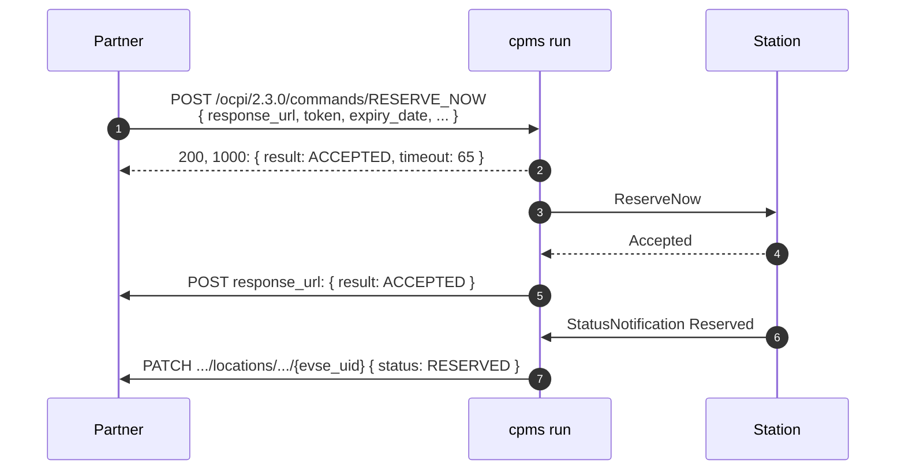

# Take commands from the partner

Once a partner is [registered](ocpi-partner.md), it can reserve an EVSE, start and stop a
session, and unlock a cable over OCPI. cpms passes each command to the station through the
same `control` layer the terminal uses, so a command from the partner and `cpms reserve`
do the same thing.

OCPI commands are **asynchronous**, and that shapes everything below:

1. The `POST` is answered **at once** with a `CommandResponse`: "I can pass this on"
   (`ACCEPTED`, with a `timeout`), or a refusal that needs no station.
2. What the station did is `POST`ed later, as a `CommandResult`, to the `response_url` of the
   request.



Spec: [Commands module](https://github.com/ocpi/ocpi/blob/release-2.3.0-bugfixes/mod_commands.asciidoc).

## Send a command

`POST {ocpi.public_base_url}/2.3.0/commands/{command}`, with the partner's `TOKEN_C`
([how to build the header](../reference/ocpi-api.md#authentication)). A `RESERVE_NOW` body,
written to `reserve.json`:

```sh
# 30 minutes from now, UTC (macOS date first, GNU date as the fallback)
expiry=$(date -u -v+30M +%Y-%m-%dT%H:%M:%SZ 2>/dev/null || date -u -d '+30 minutes' +%Y-%m-%dT%H:%M:%SZ)

cat > reserve.json <<EOF
{
  "response_url": "https://emsp.example/ocpi/commands/RESERVE_NOW/9a41",
  "token": { "uid": "NL-ABC-C00012345", "type": "RFID", "contract_id": "NL-ABC-C00012345" },
  "expiry_date": "$expiry",
  "reservation_id": "RES-0001",
  "location_id": "SITE-01",
  "evse_uid": "ALP-HYC-001-1"
}
EOF
```

The `expiry_date` has to be at least a minute ahead (anything sooner is `REJECTED`), so it is
computed rather than written down: a fixed date goes stale. `location_id` and `evse_uid` are
the ones in `config.yaml`, and the `response_url` has to be on the partner's own host (see
[Delivery](#delivery)).

```sh
TOKEN_C=change-me-token-c   # ocpi.token_c from config.yaml
auth="Authorization: Token $(printf '%s' "$TOKEN_C" | base64 | tr -d '\n')"
curl -s -H "$auth" -H 'Content-Type: application/json' -d @reserve.json \
  http://127.0.0.1:8080/ocpi/2.3.0/commands/RESERVE_NOW
```

```json
{
  "data": { "result": "ACCEPTED", "timeout": 65 },
  "status_code": 1000,
  "status_message": "Success",
  "timestamp": "2026-11-23T14:58:12Z"
}
```

`timeout` is how long the partner should wait for the `CommandResult`: the longest the
command can take (twice the charger's `call_timeout`, see
[one call in flight](../architecture/overview.md#one-call-in-flight-per-connection))
plus 5 s, using the `call_timeout` of the charger that owns the EVSE.

## The commands

| Command | Does | Notes |
|---|---|---|
| `RESERVE_NOW` | `ReserveNow` | The token's `uid` is the OCPP `idTag`. `expiry_date` must be at least a minute ahead. Without `evse_uid`, the first `AVAILABLE` reservable EVSE of the location is taken. |
| `CANCEL_RESERVATION` | `CancelReservation` | Finds the reservation by `reservation_id`. If its `RESERVE_NOW` is still with the station, cpms waits for the answer and then cancels it. |
| `START_SESSION` | `RemoteStartTransaction` | The token's `uid` is the `idTag`. Without `evse_uid`, the first `AVAILABLE` EVSE is taken. A `connector_id` needs an `evse_uid`. |
| `STOP_SESSION` | `RemoteStopTransaction` | `session_id` is [our transaction id](#stop_session-and-the-session_id). |
| `UNLOCK_CONNECTOR` | `UnlockConnector` | `evse_uid` and `connector_id` are required. |

Ids (`location_id`, `evse_uid`, `reservation_id`, ...) are `CiString`s, so case does not
matter. "The first available EVSE" is searched across the **whole location**, whatever
charger an EVSE is on.

### Answered at once

These need no station, so they are answered in the `CommandResponse` and **nothing** is
sent to the station or posted to `response_url`:

| Condition | HTTP | `status_code` | `result` |
|---|---|---|---|
| Body is not valid JSON, or lacks a field the command needs, or `response_url` is not an `http(s)` URL | 400 | `2001` | |
| `response_url` is not on a host of the registered partner (see below) | 400 | `2001` | |
| `location_id` is not ours (`RESERVE_NOW`, `START_SESSION` and `UNLOCK_CONNECTOR`; the other two do not check it) | 200 | `2003` | `REJECTED` |
| `evse_uid` or `connector_id` is unknown | 200 | `1000` | `REJECTED` |
| The charger that owns the EVSE is not connected | 200 | `1000` | `REJECTED`, "charge point offline" |
| `token.uid` is longer than 20 characters, or not printable ASCII (it has to be an OCPP 1.6 `idTag`) | 200 | `1000` | `REJECTED` |
| `RESERVE_NOW` with an `expiry_date` less than a minute ahead | 200 | `1000` | `REJECTED` |
| `RESERVE_NOW` for an EVSE with `reservable: false` | 200 | `1000` | `NOT_SUPPORTED` |
| `RESERVE_NOW` for an EVSE that holds another reservation, or with no `AVAILABLE` EVSE to pick | 200 | `1000` | `REJECTED` |
| `STOP_SESSION` for a `session_id` that is not an active transaction | 200 | `1000` | `UNKNOWN_SESSION` |
| A command type cpms does not know (the type is an open enum) | 200 | `1000` | `NOT_SUPPORTED` |

A response that is not `ACCEPTED` has `timeout: 0`: no result is coming.

!!! note "`START_SESSION` without `evse_uid`"
    The spec makes `evse_uid` optional here, and so does cpms: it picks the first
    `AVAILABLE` EVSE. Name the EVSE if the order of `location.evses` is not what you want.

!!! note "`START_SESSION` on an EVSE reserved for another tag"
    cpms does not check reservations before it passes a `START_SESSION` on, so naming an EVSE
    that is reserved for another tag is answered `ACCEPTED` like any other. The station then
    decides: a station that follows OCPP 1.6 refuses a remote start for another tag on a
    reserved connector, and the `CommandResult` is `REJECTED`. The reserved tag itself can
    start. The built-in simulator does not apply the rule, so no test shows it end to end.
    Without an `evse_uid` a reserved EVSE is never picked, because
    it does not read `AVAILABLE`.

### The result

Everything else is `ACCEPTED`, and the command then runs in the background. Its outcome is
`POST`ed to `response_url` as `{ "result": "...", "message": [{ "language": "en", "text": "..." }] }`:

| What happened | `result` |
|---|---|
| The station accepted | `ACCEPTED` |
| `Rejected` | `REJECTED` |
| `Occupied`, or cpms already holds a reservation on the EVSE | `EVSE_OCCUPIED` |
| `Faulted` or `Unavailable` | `EVSE_INOPERATIVE` |
| `UnlockFailed` | `FAILED` |
| `NotSupported`, `NotImplemented`, or a CALLERROR saying so | `NOT_SUPPORTED` |
| No answer within `charger.call_timeout` | `TIMEOUT` |
| `CANCEL_RESERVATION` for a `reservation_id` cpms does not hold | `UNKNOWN_RESERVATION` |
| Anything else: the connection dropped, the station was too busy to be sent the command | `FAILED` |

The `message` is cpms's own wording of what happened.

### Delivery

A `CommandResult` the partner does not take is sent again after 1 s, 2 s, 4 s ... (at most
30 s), up to `ocpi.push.max_retries` retries. The same rules as for the
[status push](ocpi-push.md#retries) decide what is retried: a `5xx`, `408`, `429`, or no
answer is, any other `4xx` is not. Then it is logged as an error and dropped.

Each result is delivered on its own, so a partner that is slow to take one never holds up
the next command. A result still waiting when cpms stops is lost.

!!! warning "TOKEN_B goes to the `response_url`"
    cpms authenticates the `CommandResult` with the partner's `TOKEN_B`, as OCPI has it. It
    therefore accepts a command only if its `response_url` has the same scheme and host
    (with port) as the partner's `versions` URL or one of its endpoints, as the partner gave
    them when it registered. Any other URL is answered at once with HTTP 400 and `2001`;
    nothing is sent to the station and nothing is posted.

    The check is needed because `TOKEN_C` is the same for every registration: a former
    partner that still holds it could otherwise send a command naming its own URL and be
    sent the current partner's `TOKEN_B`. **Rotate `ocpi.token_c` whenever the partner
    changes**, so that the former one is locked out altogether (see
    [OCPI partner](ocpi-partner.md)).

A `response_url` belongs to the registration its command arrived under. If that partner is
unregistered, and another registers (or the same one registers again from the start), a
result still to be sent, and the `CANCELED_RESERVATION` of a reservation made before, are
**dropped** and logged: they would otherwise go to the former partner's URL with the new
partner's `TOKEN_B`. A credentials `PUT`, which only rotates `TOKEN_B`, keeps the
registration, and results go on with the new token.

## Replace a reservation

A `RESERVE_NOW` with a `reservation_id` cpms already holds **replaces** that reservation:
there is still one reservation, under the same OCPP reservation id, with the new request's
tag, expiry and `response_url`. A 1.6 `ReserveNow` with an id the station holds replaces
it there too. The replacement must be for the same EVSE (or name none); moving a
reservation is refused at once.

If the replacement fails, cpms does **not** send `CancelReservation`, which would cancel the
original at the station too, and the failure is the result of the new command. What happens
to the original depends on what cpms knows:

- The station never saw the replacement (it was busy) or answered no: it still holds the
  original, so cpms keeps it, with its tag and expiry.
- The outcome is unknown (the station did not answer, or the connection went while the
  request was out): the station may hold either, so the original ends in cpms. The tags of
  both stay accepted at the station until their own expiry, so whichever it holds can still
  be redeemed.

## When cpms cancels a reservation

A reservation made over OCPI that **ends by the CPO's doing** is reported to its
`response_url` as `CANCELED_RESERVATION`: the spec's
"reservation canceled by the CPO" flow. That is the case when

- it was cancelled with `cpms cancel` (or from the terminal UI), and
- another tag started a session on the reserved EVSE, so the reservation failed.

Nothing is sent when it **expires** or is **redeemed** by its own tag: the partner sees both
in the [status push](ocpi-push.md), where the EVSE goes from `RESERVED` to `AVAILABLE` or
`CHARGING`. Nor when the partner cancelled it with `CANCEL_RESERVATION`: that already has
its own result.

## Which tags the station accepts

The station only starts a session for a tag it is told is valid. cpms answers `Authorize`
and `StartTransaction` with `Accepted` for

- `auth.default_id_tag` and `auth.id_tags`;
- the token `uid` of an **active reservation**, so that it can be redeemed;
- the token `uid` of a `START_SESSION`, for **15 minutes** after the command (the window OCPI
  gives a CPO to skip real-time authorisation). It is kept in memory: after a restart of cpms
  the window is gone.

The temporary tags come with an `expiryDate` in the answer's `idTagInfo`: the end of the
15-minute window for a `START_SESSION`, the reservation's expiry for a reserved tag. A
station keeps what it is told in its Authorization Cache, and an `Accepted` without an
`expiryDate` has no end. The configured tags have none.

Tags compare case-insensitively. cpms does not authorise tokens with the partner
(`POST tokens/{uid}/authorize`); the spec lets a CPO trust the eMSP to send valid ones.

## `STOP_SESSION` and the `session_id`

OCPI identifies a session by the `session_id` it learns from the Sessions module, which cpms
does not have. cpms therefore reads `session_id` as **its own transaction id**: the one
`cpms status` shows for the running session, and the one in the log. A partner learns it only
out of band. A `session_id` that is not an active transaction gets `UNKNOWN_SESSION` at once.

## Several chargers

"Offline" means the charger that owns the target EVSE: a command for an EVSE on a connected
charger works while another charger of the location is down. The `timeout` is that
charger's too.

## Limits

- A `ReserveNow` lost to a dropped connection is not cancelled when the station reconnects:
  it holds the EVSE until it expires, and cpms answers `EVSE_OCCUPIED` meanwhile. See
  [`control`](../architecture/overview.md#reservations).
- Results are not kept across a restart of cpms, and neither is the 15-minute window of a
  `START_SESSION` tag. A reservation's `response_url` is kept in `state.json`, so a
  `CANCELED_RESERVATION` after a restart is still sent.
- `cpms cancel` does not wait for a `RESERVE_NOW` still with the station: until the station
  answers, it reports no active reservation (exit 9). Only the partner's own
  `CANCEL_RESERVATION` waits.
- A `CANCEL_RESERVATION` always advertises a `timeout` of two station calls
  (`4 × call_timeout + 5 s`), even for a reservation that is already active and needs one.
- A tag the partner vouches for is accepted on **every** charger, not only the one the command
  was for.
- No Sessions module, CDRs or tariffs.

## Try it without hardware

You need a station (the simulator will do), a registered partner, and somewhere for the
results to land. A real partner is not needed: any HTTP server that answers the OCPI
versions request will register, and the script below prints what cpms sends it.

1. **Start a stand-in partner** (terminal 1). It listens on `127.0.0.1:9100`.

    ??? example "partner.py"

        ```python
        import json
        from http.server import BaseHTTPRequestHandler, HTTPServer

        BASE = "http://127.0.0.1:9100/ocpi"


        class Partner(BaseHTTPRequestHandler):
            def reply(self, data):
                body = json.dumps({"data": data, "status_code": 1000, "status_message": "Success",
                                   "timestamp": "2026-01-01T00:00:00Z"}).encode()
                self.send_response(200)
                self.send_header("Content-Type", "application/json")
                self.send_header("Content-Length", str(len(body)))
                self.end_headers()
                self.wfile.write(body)

            def do_GET(self):
                if self.path == "/ocpi/versions":
                    self.reply([{"version": "2.3.0", "url": BASE + "/2.3.0"}])
                elif self.path == "/ocpi/2.3.0":
                    self.reply({"version": "2.3.0", "endpoints": [
                        {"identifier": "locations", "role": "RECEIVER", "url": BASE + "/2.3.0/locations"}]})
                else:
                    self.send_error(404)

            def take(self):  # a command result, or a status PATCH
                n = int(self.headers.get("Content-Length", 0))
                print(self.command, self.path, self.rfile.read(n).decode(), flush=True)
                self.reply(None)

            do_POST = do_PATCH = take

            def log_message(self, *args):
                pass


        HTTPServer(("127.0.0.1", 9100), Partner).serve_forever()
        ```

    ```sh
    python3 partner.py
    ```

2. **Start cpms and the simulator** (terminals 2 and 3). `--tag` is the token `uid` of
   `reserve.json`, so the simulator can redeem the reservation with it.

    ```sh
    ./bin/cpms run
    ./bin/cpms simulate charger --id ALP-HYC-001 --tag NL-ABC-C00012345
    ```

    The simulator reads the same `config.yaml` as `cpms run` (the one in the working
    directory, or the one `-c` names): the charger, its EVSEs and the CSMS address come from
    it, and `reserve.json` has to use that file's `location_id` and EVSE uids.

3. **Register the partner.** Commands need `TOKEN_C`, which only a registered partner has:

    ```sh
    TOKEN_A=change-me-token-a   # ocpi.token_a from config.yaml
    curl -s -X POST \
      -H "Authorization: Token $(printf '%s' "$TOKEN_A" | base64 | tr -d '\n')" \
      -H 'Content-Type: application/json' \
      -d '{"token": "partner-token-b", "url": "http://127.0.0.1:9100/ocpi/versions",
           "roles": [{"role": "EMSP", "party_id": "ABC", "country_code": "NL",
                      "business_details": {"name": "Example eMSP"}}]}' \
      http://127.0.0.1:8080/ocpi/2.3.0/credentials
    ```

    The answer has `status_code` `1000` and carries `TOKEN_C`. More on this step:
    [Register an OCPI partner](ocpi-partner.md#steps).

4. **Send the command.** Write `reserve.json` as [above](#send-a-command), but with
   `"response_url": "http://127.0.0.1:9100/ocpi/commands/RESERVE_NOW/9a41"`, which is on the
   partner's host, and `POST` it. The answer comes at once, with `timeout: 65`.

5. **See the two halves.** The stand-in prints the `CommandResult` (`ACCEPTED`) and then
   the status `PATCH` (`RESERVED`), and the station shows the reservation:

    ```console
    $ ./bin/cpms status
    ...
    EVSE           STATUS     RESERVATION                         TRANSACTION  METER
    ALP-HYC-001-1  RESERVED   #1 NL-ABC-C00012345 until 10:24:49  -            -
    ```

    `./bin/cpms cancel --evse ALP-HYC-001-1` now sends `CANCELED_RESERVATION` to the same
    URL. A `START_SESSION` with the same token starts a session, and the `session_id` that
    `STOP_SESSION` takes is the transaction id in the `TRANSACTION` column of `cpms status`.

`cpms simulate charger --scenario reject-reserve` makes the result `REJECTED`, `occupied`
gives `EVSE_OCCUPIED`, `slow` gives `TIMEOUT`, and `unlock-fails` turns an
`UNLOCK_CONNECTOR` into `FAILED`. See [Test with the simulator](simulator.md).
