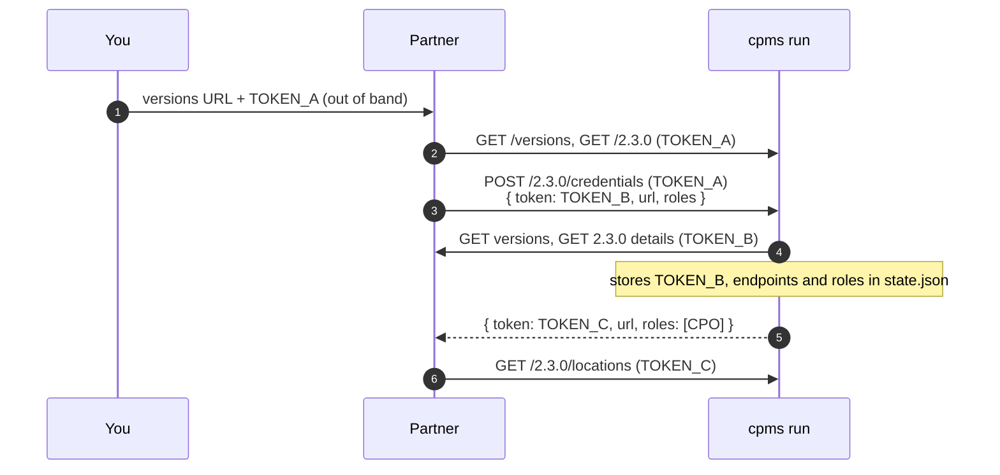

# Register an OCPI partner

Before a partner (an eMSP backend) can read your location, OCPI needs a
[credentials handshake](https://github.com/ocpi/ocpi/blob/release-2.3.0-bugfixes/credentials.asciidoc).
`cpms` is the **receiver** of it: the partner starts, cpms answers.

## The three tokens

| Token | Chosen by | Lives in | Used for |
|---|---|---|---|
| `TOKEN_A` | You | `config.yaml` (`ocpi.token_a`) | The partner's first calls: versions and credentials only. |
| `TOKEN_B` | The partner | `state.json` | cpms calling the partner. |
| `TOKEN_C` | You | `config.yaml` (`ocpi.token_c`) | Everything the partner does after registering. |

## The handshake



## Steps

1. **Start `cpms run`.** It logs the versions URL, as one of the first lines of the UI's log
   pane and in `cpms.log` (`--headless` prints it):

    ```
    OCPI versions endpoint http://192.168.1.10:8080/ocpi/versions (listening on 0.0.0.0:8080)
    ```

    The URL is `ocpi.public_base_url` + `/versions`. It must be reachable from the partner's host.

2. **Send the partner** that URL and `ocpi.token_a`, out of band.

3. **The partner registers.** It `POST`s its credentials to `{public_base_url}/2.3.0/credentials`.
   During that call cpms reads the partner's versions and 2.3.0 details with `TOKEN_B`.
   Nothing is stored unless both succeed. Each call gives up after 10 s.

4. **Check.**

    ```console
    $ cpms status
    ...
    OCPI  registered with NL*ABC since 10:05:28, push: http://emsp.example/ocpi/2.3.0/locations
    ```

    `push:` is the partner's Locations receiver, where [status changes are sent](ocpi-push.md).

From then on the partner uses `TOKEN_C`, and `TOKEN_A` gets HTTP 401. The registration
survives a restart.

??? example "Try it by hand with curl"

    ```sh
    TOKEN_A=change-me-token-a
    curl -s -X POST \
      -H "Authorization: Token $(printf '%s' "$TOKEN_A" | base64 | tr -d '\n')" \
      -H 'Content-Type: application/json' \
      -d '{
            "token": "partner-token-b",
            "url": "http://emsp.example/ocpi/versions",
            "roles": [{
              "role": "EMSP", "party_id": "ABC", "country_code": "NL",
              "business_details": {"name": "Example eMSP"}
            }]
          }' \
      http://127.0.0.1:8080/ocpi/2.3.0/credentials
    ```

    The partner's `url` must answer with OCPI versions for `TOKEN_B`, or cpms answers `3001`.

## What the partner gets back

| Answer | Means |
|---|---|
| HTTP 200, `1000` | Registered. |
| HTTP 200, `3001` | cpms could not use the partner's API: unreachable, timed out, a non-2xx answer, or a status code other than 1000. Nothing is stored. |
| HTTP 200, `3002` | The partner offers no OCPI 2.3.0. Nothing is stored. |
| HTTP 200, `2000` | Another registration change is in progress. Nothing is changed; retry shortly. |
| HTTP 400, `2001` | Invalid credentials: a missing token, one that is not 1-64 printable ASCII characters without whitespace, a URL that is not absolute, or no roles. |
| HTTP 401 | The wrong token for the current state: `TOKEN_A` after a registration, `TOKEN_C` after an unregistration. |
| HTTP 405 | `POST` while registered, or `PUT`/`DELETE` while not. |

A partner that lists no `locations` endpoint with role `RECEIVER` still registers, with a
warning in the log. It pulls locations instead of having status changes pushed.

## Change or end a registration

| Who | How | Effect |
|---|---|---|
| Partner | `PUT /2.3.0/credentials` | Replaces `TOKEN_B` and the endpoints. |
| Partner | `DELETE /2.3.0/credentials` | Unregisters. `TOKEN_A` works again. |
| You | `cpms ocpi unregister` | Clears the registration, tells the partner with a `DELETE` (best effort), and `TOKEN_A` works again. |

`cpms ocpi unregister` exits 0 once the registration is forgotten, even if the partner could
not be told: that is a `warning:` on stderr. If the partner is registering at that moment,
the command waits up to `charger.call_timeout`, then exits 9 without changing anything.
If the registration it waited for succeeds, that brand-new registration is the one cleared.

!!! warning "Deviation from the spec: `TOKEN_C` does not change on `PUT`"
    OCPI says the server must generate a new token when the partner `PUT`s its credentials.
    cpms answers with the same `ocpi.token_c`, because its tokens live in `config.yaml`,
    which it never writes.

    **To rotate it:** change `ocpi.token_c`, restart, run `cpms ocpi unregister`, and have
    the partner register again.

!!! warning "Rotate `TOKEN_C` when the partner changes"
    `TOKEN_C` is the same for every registration. After `cpms ocpi unregister`, a former
    partner that still has it can call everything `TOKEN_C` opens, such as the Locations
    module and the commands. cpms only sends command results to the registered partner's
    own hosts, so the former partner cannot be sent the new partner's `TOKEN_B`, but it can
    still try to act on your chargers. Before another partner registers, change
    `ocpi.token_c` and restart.

## Next

- What cpms sends the partner: [Push status to the partner](ocpi-push.md)
- What the partner can call: [OCPI API reference](../reference/ocpi-api.md)
- Token rules: [Configuration](../reference/configuration.md#ocpi)
