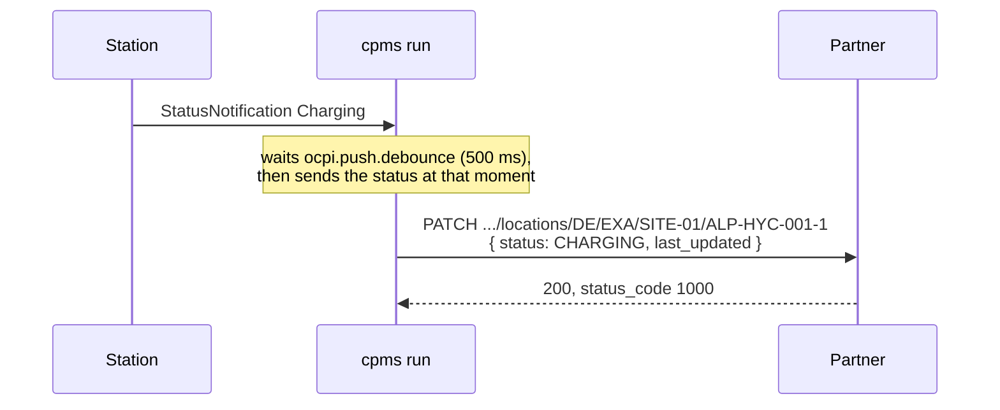

# Push status to the partner

Once a partner is [registered](ocpi-partner.md), cpms tells it about every EVSE status
change, so it does not have to poll. It makes no difference whether the change came from
`cpms reserve` or from someone plugging in a car.



## The request

```
PATCH {partner's locations RECEIVER url}/{country_code}/{party_id}/{location.id}/{evse uid}
Authorization: Token <base64 of TOKEN_B>
```

```json
{ "status": "CHARGING", "last_updated": "2026-11-19T14:31:05Z" }
```

`last_updated` is when the status changed, not when the `PATCH` went out. A retry keeps it.
Spec: [Locations module, receiver interface](https://github.com/ocpi/ocpi/blob/release-2.3.0-bugfixes/mod_locations.asciidoc).

## When it pushes

| Event | Result |
|---|---|
| An EVSE status changes | One `PATCH` after `ocpi.push.debounce`, carrying the status at the end of the wait. |
| Five changes inside the wait | Still one `PATCH`, with the last status. An older status can never overwrite a newer one. |
| An EVSE flaps for minutes | One `PATCH` per window: the window does not restart on every change. |
| The station disconnects | Every EVSE becomes `UNKNOWN`, so each gets its own `PATCH`. |
| No registration, or the partner lists no `locations` receiver | No call, and nothing logged above debug level. |
| A partner registers while cpms runs | It gets the next change. |

The header of the [terminal UI](terminal-ui.md) shows the last push, or the last failure
in red.

Not pushed:

- A full state after registration. The partner reads it with `GET` [locations](../reference/ocpi-api.md#locations).
- Anything but EVSE status.
- Anything unsent when cpms stops. After a restart the station reconnects and statuses change anyway.

## Retries

A `PATCH` the partner does not accept is tried again after 1 s, 2 s, 4 s ... (at most 30 s,
each with up to a quarter more as jitter). `ocpi.push.max_retries` (default `5`) is the
number of retries after the first attempt.

| Partner's answer | Retried |
|---|---|
| HTTP `5xx`, `408`, `429` | yes |
| A timeout or connection error | yes |
| A `status_code` other than 1000 | yes |
| Any other `4xx` | no: sending it again would not change the refusal |

- If the EVSE changes again while a retry waits, the retry sends the new state. Retries do
  not stack.
- When the retries run out, the change is dropped with an error log. The next change starts afresh.

## See how it is doing

`cpms status` shows the push at the end of the OCPI line:

=== "Healthy"

    ```
    OCPI  registered with NL*ABC since 14:02:11, push: https://emsp.example/ocpi/2.3.0/locations (last push 14:31:07)
    ```

=== "Failing"

    ```
    OCPI  registered with NL*ABC since 14:02:11, push: https://emsp.example/ocpi/2.3.0/locations (last push failed 14:31:07: ocpi: HTTP 500: Internal Server Error, 1 pending)
    ```

`cpms status --json` has the same under `ocpi.push`, while registered:

| Field | |
|---|---|
| `last_success` | When a push last got through |
| `last_error`, `last_error_at` | Why and when it last failed |
| `pending` | How many EVSEs have a change waiting |

In the log, a change that is dropped or refused is an **error** naming the EVSE and the last
HTTP status or OCPI code. Retries in between are debug lines.

!!! info "A failing push never holds up the station"
    It does not stop `cpms run` either. A slow partner cannot make cpms miss events: if
    some are lost anyway, it logs a warning and pushes every EVSE once.
