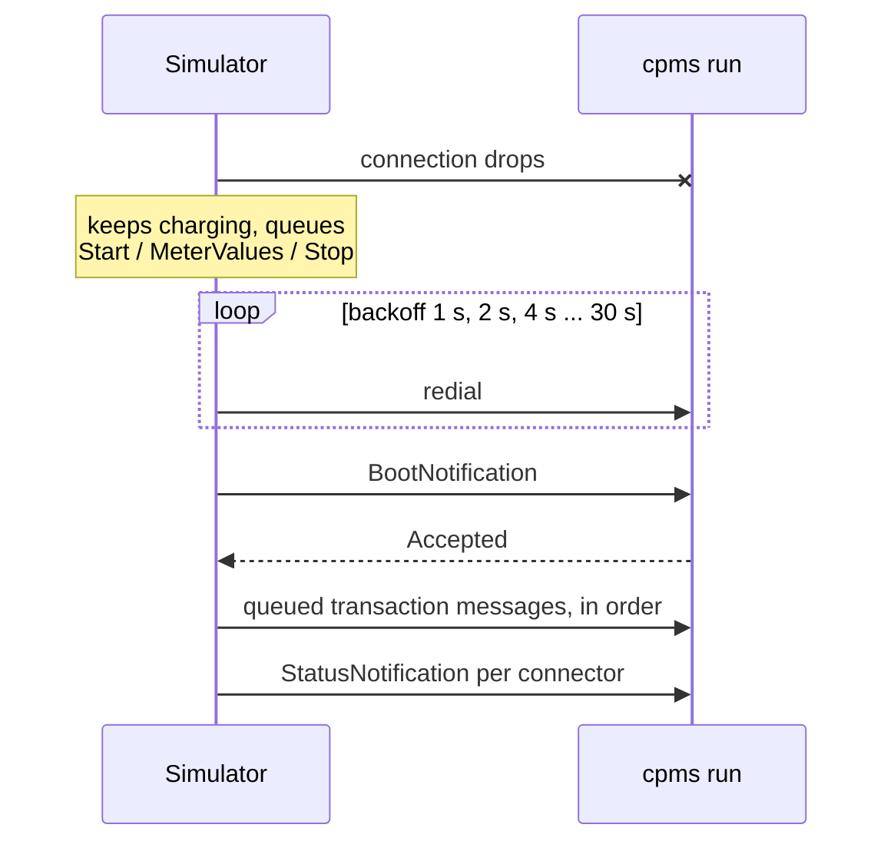

# Test with the simulator

`cpms simulate charger` is a charge point built into the binary. It dials a CSMS and
behaves like a station, so everything runs on a laptop and in CI.

```sh
cpms run                 # terminal 1
cpms simulate charger    # terminal 2
```

With no flags it reads the same config and connects to the CSMS that `cpms run` serves.

## Scenarios

`--scenario` makes the station misbehave on purpose. This is how the unhappy paths are tested.

| Scenario | Behaviour | Tests |
|---|---|---|
| `normal` | A cooperative station (default). | The happy path |
| `reject-reserve` | Refuses every `ReserveNow` and stops advertising the Reservation profile. | `cpms probe` exit 10 |
| `occupied` | Answers `ReserveNow` with `Occupied`. | Exit 5 |
| `slow` | Stalls every answer past the call timeout. | Exit 7 |
| `unlock-fails` | Refuses to release the cable lock. | Exit 8 |
| `silent` | Boots, then sends nothing while still answering pings. | `heartbeat_timeout` |
| `reject-profile` | Answers every `SetChargingProfile` with `Rejected`. | `cpms limit`, exit 4 |
| `offline-tx` | Charges through an outage and replays it. See [Offline](#offline-and-reconnect). | Transaction replay |

## Flags

| Flag | Default | Does |
|---|---|---|
| `--scenario` | `normal` | See above. |
| `--meter-interval 10s` | off | Sends `MeterValues` this often during a session. |
| `--reconnect` | off | Redials when the connection drops, instead of exiting. |
| `--allow-foreign-tag` | off | Lets another tag start on a reserved connector. |
| `--csms URL` | from `server.ocpp_bind` | The CSMS to dial. |
| `--id`, `--connectors`, `--tag` | from config | Fake a different station. |
| `--vendor`, `--model` | Alpitronic HYC300 | What `BootNotification` reports. |
| `--log-level` | `info` | `debug`, `info`, `warn` or `error`. |

## Meter values

With `--meter-interval`, a running session streams four readings from a simulated car:

| Measurand | Value |
|---|---|
| `Power.Active.Import` | 50 kW, constant, capped by any charging limit |
| `Current.Import` | Power at 400 V |
| `Energy.Active.Import.Register` | Rises with power × time |
| `SoC` | From 20 % on a 75 kWh battery, full after about 72 minutes |

When the battery is full, power and current drop to 0 and the connector reports
`SuspendedEV` once, as a real car does. The session runs on until it is stopped.

Without `--meter-interval` nothing is streamed and a session moves the meter by a flat
1000 Wh. The `silent` scenario never sends meter values.

??? note "Configuration keys the simulator answers"
    `ChangeConfiguration` works for `MeterValueSampleInterval`, `HeartbeatInterval` and
    `ConnectionTimeOut`. `MeterValuesSampledData` is read-only (the stream does not follow
    it), so `cpms config set` gets `Rejected` there.

## Charging profiles

The simulator advertises the SmartCharging profile and answers `SetChargingProfile`,
`ClearChargingProfile` and `GetCompositeSchedule`.

| Limit | Value |
|---|---|
| Rate units | `Power` and `Current` |
| Max stack level | 8 |
| Max periods per schedule | 24 |
| Max profiles installed | 10 |

Beyond those it answers `Rejected`. The streamed power and current follow the active limit.

??? note "How the simulator applies profiles"
    - Profiles are kept per connector (`0` is the station). One with the same id, or the
      same purpose and stack level, replaces the one before.
    - A `TxProfile` needs a running transaction and ends with it. A `TxDefaultProfile` can
      be set while the connector is reserved.
    - The limit is the highest stack level per purpose, `TxProfile` over
      `TxDefaultProfile`, capped by the connector's share of `ChargePointMaxProfile`.
    - `ChargePointMaxProfile` is split evenly between the connectors with a running
      transaction. An unused share is not handed to the others.
    - Simplified: `Relative` schedules start "now", `Recurring` ones are read in their
      current recurrence only, and `GetCompositeSchedule` does not convert units (asking in
      A for profiles in W is `Rejected`).
    - Profiles survive a reconnect and a `Reset` (OCPP 1.6 errata 3.37), but not a restart
      of the simulator.

## Reservations

A reserved connector refuses a start for any tag but the reserved one, as
OCPP 1.6 §5.13 requires: a local start fails, a `RemoteStartTransaction` is `Rejected`, and
the reservation stays. The reserved tag's start carries `reservationId`.

`--allow-foreign-tag` turns the refusal off, to test how a CSMS copes: the session starts
without `reservationId` and the reservation is dropped.

## Offline and reconnect

By default the simulator exits when its connection drops. With `--reconnect` it behaves
like a station:



The `offline-tx` scenario runs that end to end. It implies `--reconnect` and
`--meter-interval 1s`. It starts a transaction on connector 1 and waits for the connection
to drop (stop `cpms run`). Offline it queues 3 meter values, stops the transaction, and
starts and stops a second one. Then it redials and delivers the queue.

A queued message leaves the queue only when the CSMS has answered it:

| Answer | What happens |
|---|---|
| `CALLRESULT` | Delivered. |
| `CALLERROR`, or no answer in time | Sent again after the backoff, at most 3 times, then given up. |
| The connection drops | Stays queued, with everything behind it. |

??? note "Details of the offline queue"
    - Each message keeps the timestamp it was made with. Status changes are not queued: the
      status round after the boot reports where each connector ended up.
    - A session started offline runs under a placeholder id that never goes on the wire.
      Once the CSMS has answered the `StartTransaction`, the queued `MeterValues` and
      `StopTransaction` carry the CSMS's id.
    - A `StartTransaction` that is given up takes its session's queued messages with it,
      and a session still running ends locally.
    - A replayed `StartTransaction` answered with an `idTagInfo.status` other than
      `Accepted` ends a running session with reason `DeAuthorized` (OCPP 1.6 §3.5.4).
    - The queue lives in memory. Offline starts are always allowed:
      `LocalAuthorizeOffline` and `AllowOfflineTxForUnknownId` are not consulted yet.
    - The first dial is not retried: a CSMS that cannot be reached at start-up is more
      likely a wrong `--csms` than an outage. A `BootNotification` the CSMS rejects after a
      reconnect makes the simulator exit non-zero.
    - Rules followed: OCPP 1.6 §3.7 (queue order) and §3.7.1 (retries).
    - For tests, `simulator.Options.ResumeWithoutBoot` makes a redial skip the boot and
      the status round, like the Alpitronic HYC50.
