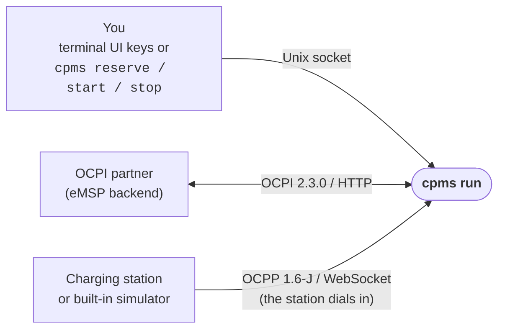

---
hide:
  - navigation
---

# headless-csms

**A charge point management system in one binary.** `cpms` drives a single
[OCPP](https://openchargealliance.org/protocols/open-charge-point-protocol/) charging
station from the terminal and exposes it to a roaming partner over
[OCPI 2.3.0](https://github.com/ocpi/ocpi/tree/release-2.3.0-bugfixes).

No database, no container, no web UI: one config file, one binary.

[Quickstart :material-arrow-right:](quickstart.md){ .md-button .md-button--primary }
[CLI reference](reference/cli.md){ .md-button }



## Try it in two minutes

No hardware needed: a charge point simulator is built in.

```sh
git clone https://github.com/wolffseb/headless-csms.git && cd headless-csms
make build && cp config.example.yaml config.yaml

./bin/cpms run                 # terminal 1: the CSMS, with its terminal UI
./bin/cpms simulate charger    # terminal 2: a fake station
./bin/cpms reserve --evse ALP-HYC-001-1 && ./bin/cpms status   # terminal 3
```

The [quickstart](quickstart.md) walks through it, output included.

## What it does

| Capability | How | State |
|---|---|---|
| Reserve, start, stop, unlock | [`cpms reserve`, `start`, `stop`, `unlock`](guides/charging-session.md) | :material-check: |
| See what a station supports | [`cpms probe`](reference/probe.md) | :material-check: |
| Read power and current | [`cpms status`](guides/metering.md) | :material-check: |
| Limit charging power | [`cpms limit`, `cpms profile`](guides/smart-charging.md) | :material-check: |
| Test without hardware | [`cpms simulate charger`](guides/simulator.md) | :material-check: |
| OCPI versions, credentials, locations | [OCPI API](reference/ocpi-api.md) | :material-check: |
| Push status changes to the partner | [OCPI `PATCH`](guides/ocpi-push.md) | :material-check: |
| OCPI commands (`RESERVE_NOW`, ...) | [Commands module](guides/ocpi-commands.md) | :material-check: |
| Operate from one screen | [Terminal UI of `cpms run`](guides/terminal-ui.md) | :material-check: |
| OCPP 2.0.1 | | planned |

The full list is in the [roadmap status](development.md#status).

## Where to go next

<div class="grid cards" markdown>

-   :material-rocket-launch: **[Quickstart](quickstart.md)**

    Build, run, and drive a simulated station.

-   :material-book-open-variant: **[Concepts](concepts.md)**

    Who connects to whom, and the six words you need.

-   :material-ev-plug-ccs2: **[Connect a real station](guides/connect-station.md)**

    Point a charger at `cpms` and check what it supports.

-   :material-handshake: **[Register an OCPI partner](guides/ocpi-partner.md)**

    The credentials handshake, step by step.

-   :material-console: **[CLI reference](reference/cli.md)**

    Every command, flag and exit code.

-   :material-sitemap: **[Architecture](architecture/overview.md)**

    How the code is put together, with sequence diagrams.

</div>

---

A personal hobby project under the [MIT license](https://github.com/wolffseb/headless-csms/blob/main/LICENSE).
It is used as an internal test environment at Fryte, but it is not an official Fryte
product and Fryte does not maintain or support it.
